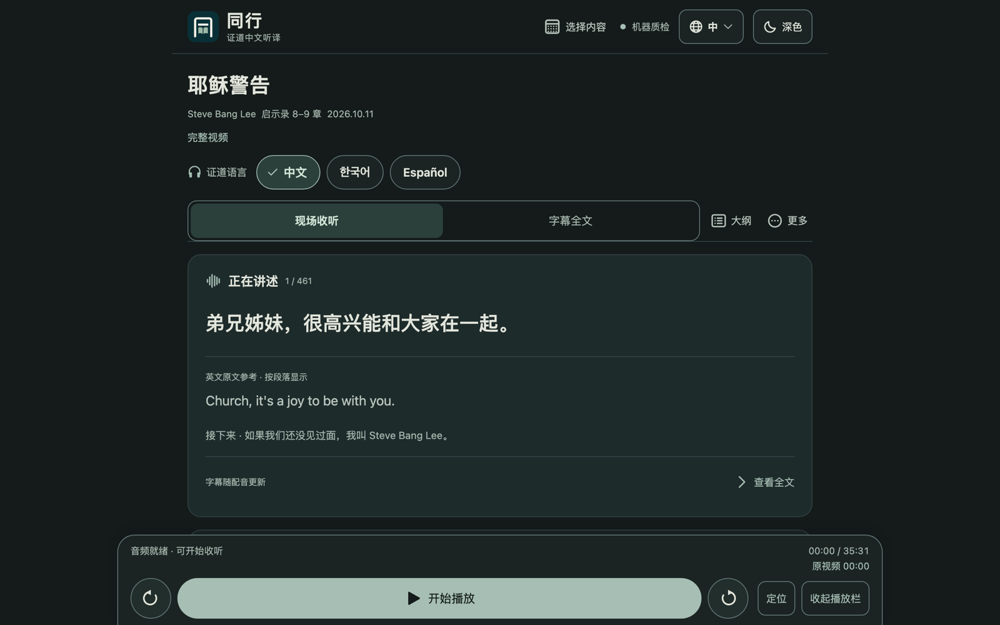
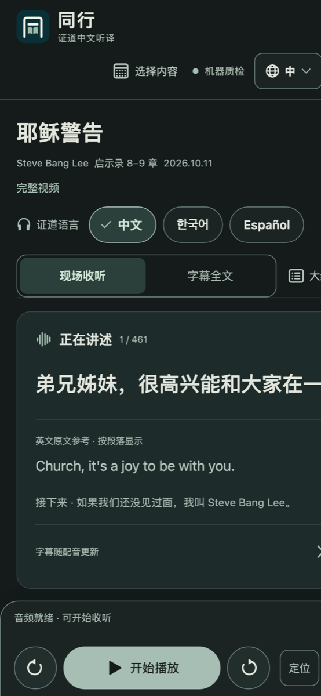
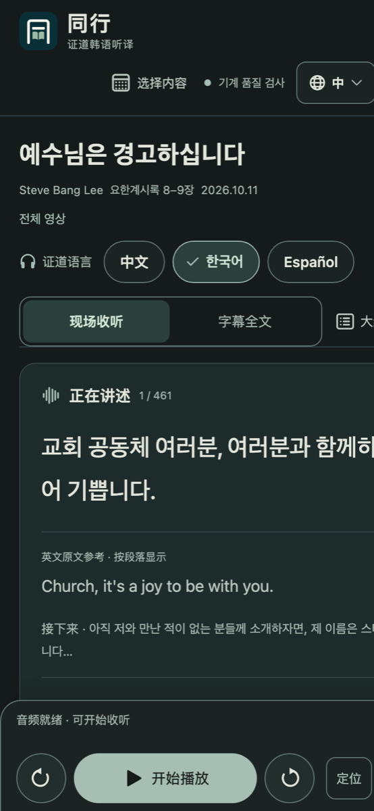
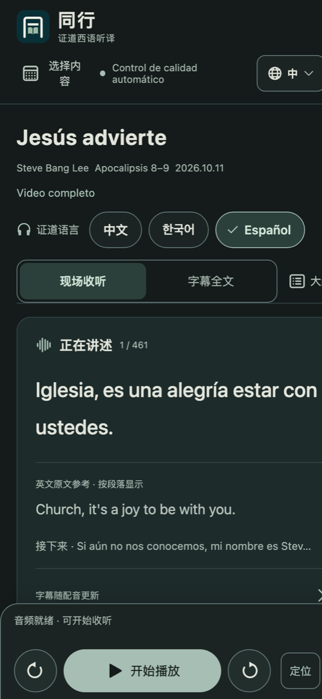
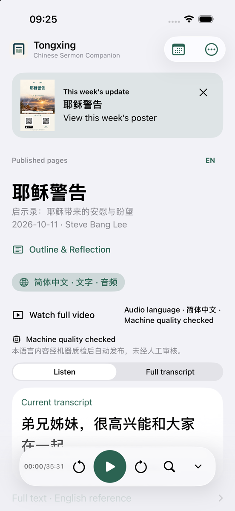
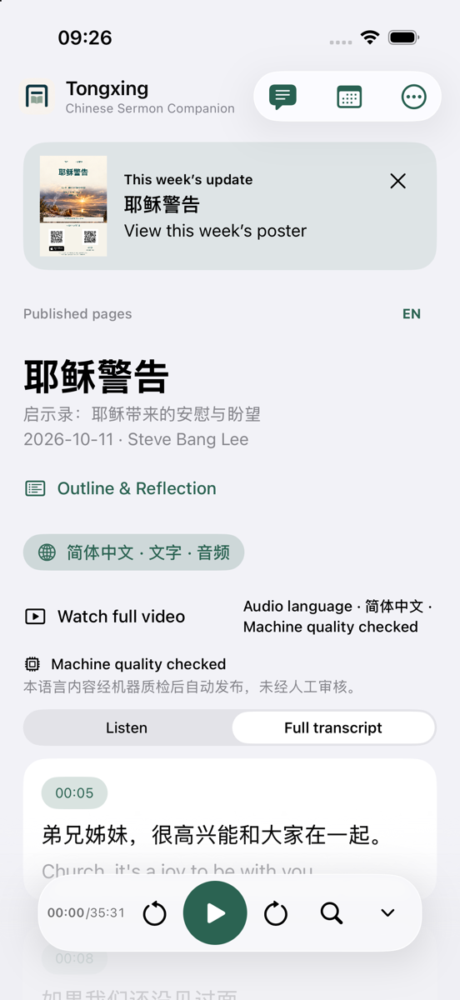
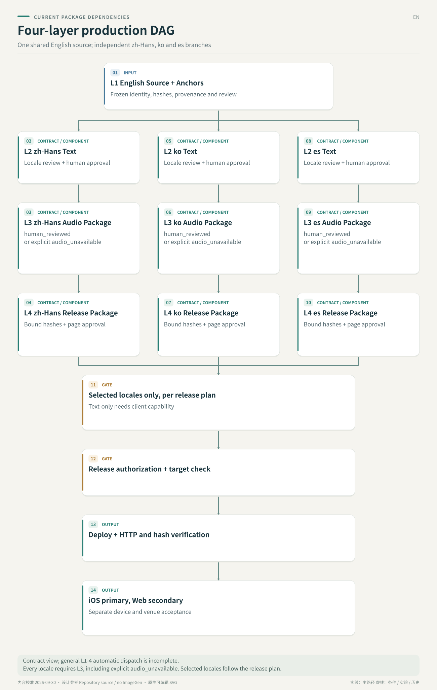
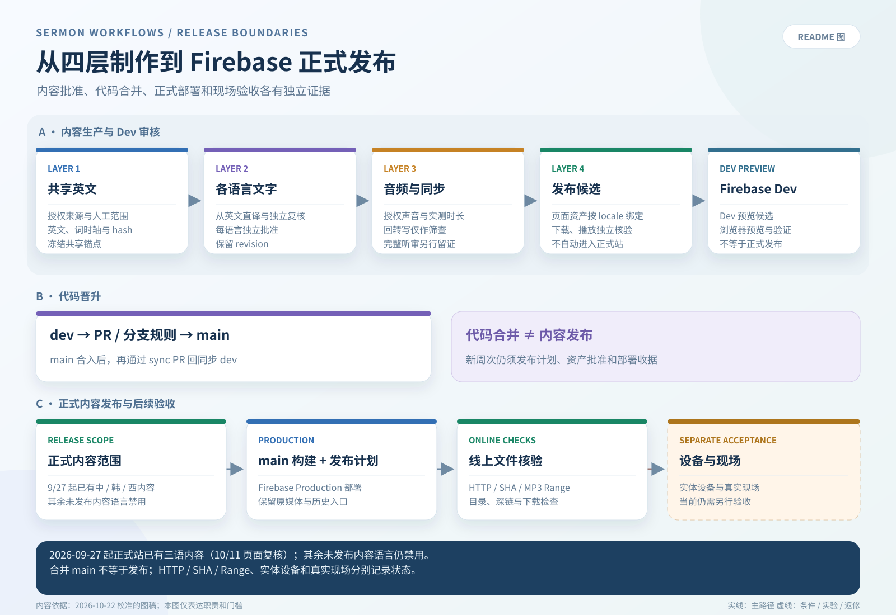
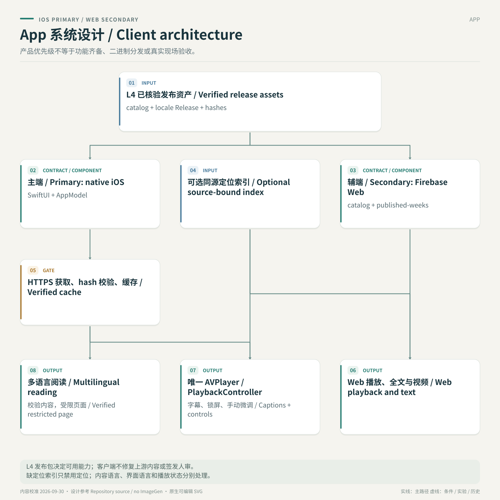

# Tongxing (同行): multilingual sermon listening, reading and live captions

  
  
  
  
  

Tongxing turns one English sermon recording into reviewed Chinese, Korean and Spanish text, generated speech in the speaker's own voice, timed captions, a study outline and a weekly page that attendees open on the web or in a native iOS app. A separate local path produces live Chinese captions during a Sunday service, and a third path produces a bilingual reading PDF and a Chinese companion.

Every generated artifact is bound to its inputs by hash, carries its review status honestly, and is published only after the checks for its own layer pass. There are usually about 10 to 12 hours between receiving the source video and the next service, so the backend is built to resume, reuse paid results and stop on unknown outcomes instead of retrying blindly.

This is an independent personal open-source project with no affiliation, endorsement or operational relationship with Mariners Church. Use public or authorized media and keep the source and review status of generated translations, speech and explanations visible.

## What it looks like

Browser captures of the Production page for the 2026-10-11 sermon. The page language and the sermon language are separate controls; the three sermon languages share one English source. Screenshots show rendering only, not device or venue acceptance.

| Chinese | Korean | Spanish |
|---|---|---|
|  |  |  |

The native iOS client reads the same release packages. iPhone 17 Pro simulator captures of the `Tongxing` scheme in its Release configuration, showing the weekly update card, the machine-quality-checked disclosure, the listening view and the full transcript:

  
  

## Main modules

| Module | What it does | Where it lives | Read next |
|---|---|---|---|
| Four-layer production backend | Freezes the English source, translates and reviews each language, renders and times speech, assembles per-locale release packages | `scripts/`, `schemas/`, `config/` | [Four-layer contract](docs/multilingual-production-interfaces.zh.md) · [Backend design](docs/backend-workflow-system-design.zh-en.md) |
| Web reader (Firebase Hosting) | Weekly page with captions that follow the audio, full bilingual text, outline, language pickers and sound-based position alignment | `apps/listening-web/`, `firebase/` | [Layer 4 public delivery](docs/layer4-four-product-public-delivery.zh.md) · [Weekly release](docs/tongxing-weekly-release.zh.md) |
| iOS client | SwiftUI + AVPlayer app with verified caching, background audio, lock-screen controls, Dynamic Island state, microphone alignment and a Beta channel | `apps/tongxing-ios/` | [iOS README](apps/tongxing-ios/README.zh.md) · [Design conventions](apps/tongxing-ios/DESIGN.zh.md) |
| Sunday live captions | Local microphone to live Chinese captions with recording kept for recovery; a separate `live_session` delivery type | `experiments/local-live-poc/` | [Live POC](experiments/local-live-poc/README.md) · [Operations whitepaper](docs/sunday-live-operations-whitepaper.zh.md) |
| Dual-PDF reading edition | Bilingual reading PDF and Chinese sermon companion from a confirmed recording | `scripts/` | [Stable post-live workflow](docs/stable-post-live-reading-pdf-workflow.md) |
| Supervisor and run tooling | Run journal, budget planner, start checks, Spark session control, run reports | `scripts/`, `docs/reports/` | [Supervisor contract](docs/sermon-production-supervisor-agent.md) · [Run retrospective template](docs/test-run-retrospective.zh.md) |
| Experiments | Model trials, A/B comparisons, benchmarks, Decisions API studies | `experiments/`, `config/agent-trials/` | [Experiment directions](docs/experiment-directions.zh.md) · [Model output speed index](docs/model-output-speed-index.zh.md) |

## Architecture

### Four layers, one English source

One shared English source feeds independent Chinese, Korean and Spanish branches. Each branch goes through text, then audio, then release, with its own review and hashes. A changed Layer 1 identity invalidates every locale; a changed Layer 2 or 3 artifact invalidates only that locale's downstream work. No layer is skipped and no upstream content is repaired downstream.

| Layer | Name | Formal output | Gate |
|---|---|---|---|
| 1 | Shared English Source & Anchors | English Source Package | Completeness, word alignment and sentence boundaries reviewed; identity frozen |
| 2 | Target-Language Text | Target-Language Candidate per locale | Independent model review, text machine QC, then human approval or a recorded machine waiver |
| 3 | Target-Language Audio & Synchronization | Target-Language Audio Package per locale, or explicit `audio_unavailable` | Back-transcription screening, timing plan, human listening or a recorded waiver |
| 4 | Multilingual Delivery & Playback | Release Package per `pageId + targetLocale` | Deploy, then HTTP, hash and Range verification; device and venue acceptance recorded separately |

The per-layer process, models and gates are drawn in the [four-layer workflow diagram](docs/diagrams/four-layer-production-workflow.svg). The maintained contract is the [four-layer interface document](docs/multilingual-production-interfaces.zh.md); the Python dependency definition is in `scripts/canonical_pipeline_definition.py`.

### From content approval to Firebase release

Content approval, code promotion, Production deployment and device or venue acceptance each leave their own evidence. Merging code to `main` is not a content release, and a Dev preview page is not a Production page.

### Clients

The native iOS app is the primary listening client and the Firebase web page is the secondary access point. Both consume only the capabilities that a Layer 4 release package declares: they verify hashes, cache verified files and never translate, synthesize or re-review content on the device.

More diagrams, their sources and the regeneration command are listed in the [diagram inventory](docs/diagrams/README.md). The [execution environment design](docs/execution-environment-design.zh.md) shows how the MacBook, the DGX Spark, model APIs, Firebase and CI divide the work.

## Technical implementation

**Backend.** Python 3 producers in `scripts/` with JSON schemas in `schemas/` and frozen policies in `config/`. Every package records canonical source ID and URL, media hash and duration, approved window, model and prompt identity and review receipts. Runs resume from verified artifacts; durable jobs, response caches and a budget ledger make paid model calls reusable across restarts. Human acceptance, machine waivers and budget approvals are separate receipts written by separate scripts, so a machine pass can never be mistaken for human approval.

**Models and compute.** Translation and independent review run through a frozen Layer 2 backend chosen per run; speech rendering, back-transcription and word alignment run on a local DGX Spark with a MacBook fallback. Model names, reasoning levels, tiers and budget caps live in the [runtime model policy](docs/production-model-runtime-policy.zh.md), the [compute policy](docs/local-production-compute-policy.zh.md) and the [weekly run profile](docs/weekly-run-profile.zh.md); the Layer 2 [controller](docs/canonical-layer2-controller.zh.md) covers concurrency and recovery. OpenAI projects are used only through the [environment launcher](docs/openai-minimal-project-setup.zh.md).

**Quality gates.** Text machine QC checks meaning preservation, numerals, Scripture references and terminology from the [shared terminology table](docs/series-terminology.zh.md); audio QC screens rendered speech by back-transcription and timing. A failing check goes back into a bounded repair loop. Publication without human review requires a [machine-quality waiver](docs/machine-quality-waiver.zh.md) that binds the implementation, runtime settings, frozen source and audio, and the page shows the disclosure.

**Web.** Static ES modules with no framework, served by Firebase Hosting from separate Dev and Production projects. The page validates the catalog and each release package before enabling a language, follows captions from the audio timeline, and offers a short microphone capture that matches against a source-bound fingerprint index to jump to the current position. Full videos live in a storage bucket with exact redirects. Node tests cover the shared client contracts.

**iOS.** SwiftUI and AVPlayer, minimum iOS 17, no third-party SDKs. Two local Swift packages hold the catalog and release decoding, playback history and verified storage. Production and Beta share one source tree with separate bundle identities; Beta adds Dynamic Island alignment state, local notifications and single-device APNs testing. See the [iOS design section](#ios-client-design) below.

**Live captions.** A local gateway owns microphone capture, ASR and translation, keeps a recovery recording and renders operator and viewer pages. Live captions use what is being said in that session; a recording reused later for durable content starts again at Layer 1.

**Testing and CI.** Python tests under `tests/`, Node tests beside the web modules, Swift package and simulator tests under `apps/tongxing-ios/`. GitHub Actions run a path-classified Python suite, an iOS contract or simulator job and a promotion policy for `main`. Policy, routing and sharding are documented in the [CI/CD backlog](docs/ci-cd-backlog.zh.md).

## Workflows

### Weekly prepared content

1. **Source.** Download the authorized recording, confirm the sermon window and freeze the English Source Package with word alignment ([runbook](docs/codex-local-production-runbook.zh.md)).
2. **Text.** Produce a candidate per locale, run independent review and machine QC, then human text review or a recorded waiver.
3. **Audio.** Prepare the speech job, render with the authorized speaker voice on the Spark, screen by back-transcription, compact silences and build the audio package ([formal Layer 3 renderer](docs/formal-layer3-renderer.zh.md)).
4. **Release.** Build the release package, publish to the Dev project, verify HTTP, hashes and a browser smoke, then deploy to Production under the [weekly release contract](docs/tongxing-weekly-release.zh.md).
5. **Poster and report.** Render the [single-line weekly poster](docs/tongxing-weekly-poster-format.zh.md) and export a redacted [run report](docs/test-run-retrospective.zh.md) as a docs-only PR.

A short real-model rehearsal of the same path on a clip is the [clip E2E](docs/clip-real-e2e.zh.md). The [workflow map](docs/workflows/README.zh.md) is the source of truth for scope and completion states.

### Code and content release

Feature branches merge into `dev` through required checks. A weekly `dev → main` promotion PR runs the full Python suite, the iOS simulator job and the promotion policy, is squash-merged, and is followed by a checked `sync/main-to-dev` PR. Firebase Production content deployment is a separate step with its own admission receipts. Details: [branch and Firebase environment policy](docs/development-branch-and-firebase-environments.zh.md).

### Sunday live session

[Prepare a session](docs/sunday-live-agent-runbook.zh.md) opens the operator page in standby; the [operations whitepaper](docs/sunday-live-operations-whitepaper.zh.md) covers audio input, phone display and degradation. The [fallback skill](skills/live-caption-zh-fallback/SKILL.md) is the offline backup.

### Dual-PDF reading edition

Confirm the source, boundaries and text, then review both PDFs: [stable post-live workflow](docs/stable-post-live-reading-pdf-workflow.md).

## iOS client design

The app follows the iOS 27 design language with system navigation and sheets, 26 pt captions that grow with Dynamic Type, a single-layer Liquid Glass playback bar and semantic colors in light and dark appearance. Design iterates in Xcode and SwiftUI rather than in a separate design tool: screenshot annotation, native implementation, build and real interaction, independent review, then web adaptation where it applies.

- [Design conventions](apps/tongxing-ios/DESIGN.zh.md): navigation, captions, playback bar, sheets, accessibility and iPhone Duo layout.
- [UI iteration workflow](apps/tongxing-ios/UI-ITERATION-WORKFLOW.md) (English) and the [iOS README](apps/tongxing-ios/README.zh.md): modules, build and test steps, data contracts.
- [Sound alignment](apps/tongxing-ios/FINGERPRINT-ALIGNMENT.zh.md) and the shared [field alignment contract](docs/sermon-app-field-alignment.zh.md).
- [Weekly updates and poster discovery](apps/tongxing-ios/WEEKLY-UPDATES.zh.md), [APNs setup](apps/tongxing-ios/APNS-SETUP.zh.md), [icon inventory](apps/tongxing-ios/ICON-INVENTORY.zh.md).
- [Versioning](apps/tongxing-ios/VERSIONING.zh.md), [Beta promotion](apps/tongxing-ios/BETA-PROMOTION.zh.md), [TestFlight automation](apps/tongxing-ios/TESTFLIGHT-AUTOMATION.zh.md) and the [release readiness checklist](apps/tongxing-ios/RELEASE-READINESS.zh.md).

A simulator build is not TestFlight, physical-device or venue acceptance; each is recorded separately in the dated release notes under `apps/tongxing-ios/`.

## Repository layout

| Path | Contents |
|---|---|
| `scripts/` | Production, QC, release, supervisor and experiment tooling |
| `schemas/` | Versioned JSON schemas for every package and receipt |
| `config/` | Frozen policies, run profiles, adapters and agent-trial fixtures |
| `tests/` | Python test suite |
| `apps/tongxing-ios/` | iOS app, Swift packages, UI tests and release records |
| `apps/listening-web/` | Web reader modules and Node tests |
| `firebase/` | Hosting configuration and Dev page adapters |
| `experiments/local-live-poc/` | Sunday live caption runtime |
| `docs/` | Contracts, runbooks, design documents, diagrams and dated reports |
| `skills/` | Agent skills for Spark, dubbing, alignment and live fallback |

Source videos, complete audio, private media, credentials and run artifacts stay outside Git.

## Learn more

- [Documentation index](docs/README.md) and the [project technical overview](docs/project-technical-overview.md).
- [Development backlog](docs/backlog.zh.md): priorities, stable IDs and status.
- [Weekly production retrospective](docs/blog/sermon-production-workflow-lessons.zh.md): what the 10-to-12-hour window taught us.
- [Contributing](CONTRIBUTING.md) and [security policy](SECURITY.md).

Contributions through issue reports, user feedback, translation review and code improvements are welcome. Include the week, language and setting when reporting a problem so content, playback and venue issues can be understood separately.
