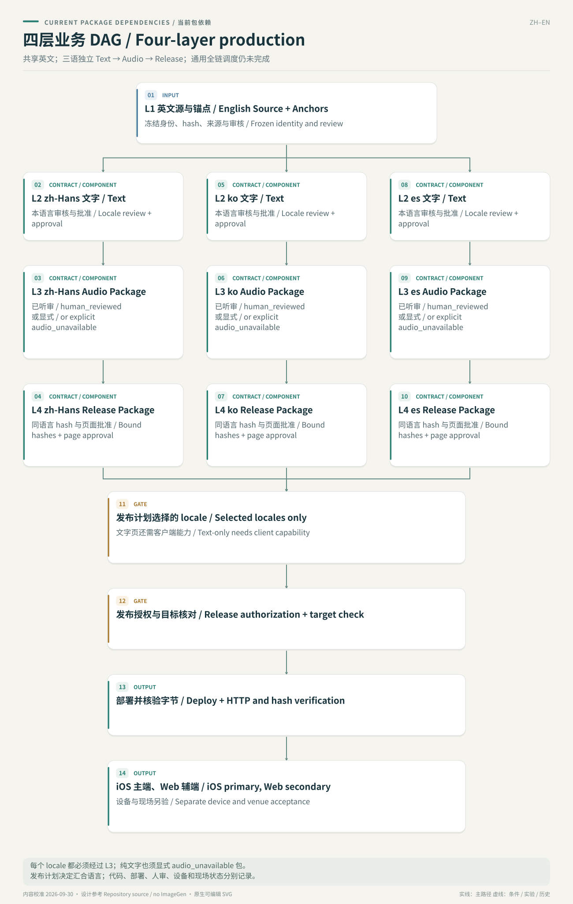

# 同行（Tongxing）：多语言证道听译、阅读与实时字幕

  
  
  
  
  

同行把一场英文证道录音转换成经过审核的中文、韩语和西班牙语文字、讲员本人音色的合成配音、随声字幕、学习大纲和每周页面，会众可以在网页或原生 iOS App 中打开。另一条本地路径在主日现场生成中文实时字幕；第三条路径生成中英对照阅读 PDF 和中文证道同行稿。

每个生成产物都通过哈希绑定其输入，如实标注审核状态，只有本层检查通过后才发布。从拿到源视频到下一场证道通常只有 10 到 12 小时，所以后端的设计重点是可恢复、复用已付费结果，遇到结果未知时停下来而不是盲目重试。

这是独立的个人开源项目，与 Mariners Church 无隶属、背书或运营关系。使用公开或已获授权的媒体，并让生成的翻译、配音和说明保留来源与审核状态。

## 界面截图

以下是 2026-10-11 证道在正式站的浏览器截图。页面语言和证道语言是两个独立控件；三种证道语言共用同一份英文来源。截图只说明渲染结果，不代表设备或现场验收。

| 中文 | 韩语 | 西班牙语 |
|---|---|---|
|  |  |  |

原生 iOS 客户端读取同一套发布包。下面是 `Tongxing` scheme Release 配置在 iPhone 17 Pro 模拟器中的截图：本周更新卡片、机器质检声明、收听视图和全文视图。

  
  

## 主要模块

| 模块 | 作用 | 位置 | 进一步阅读 |
|---|---|---|---|
| 四层生产后端 | 冻结英文来源，逐语言翻译与复核，渲染并对齐配音，组装逐 locale 发布包 | `scripts/`、`schemas/`、`config/` | [四层生产合同](docs/multilingual-production-interfaces.zh.md) · [后端设计](docs/backend-workflow-system-design.zh-en.md) |
| Web 阅读器（Firebase Hosting） | 每周页面：随声字幕、双语全文、大纲、语言选择和听声定位 | `apps/listening-web/`、`firebase/` | [Layer 4 公开交付](docs/layer4-four-product-public-delivery.zh.md) · [每周发布](docs/tongxing-weekly-release.zh.md) |
| iOS 客户端 | SwiftUI + AVPlayer，校验缓存、后台音频、锁屏控制、灵动岛状态、麦克风定位和 Beta 渠道 | `apps/tongxing-ios/` | [iOS README](apps/tongxing-ios/README.zh.md) · [设计约定](apps/tongxing-ios/DESIGN.zh.md) |
| 主日实时字幕 | 本地麦克风到中文实时字幕，保留恢复录音；独立的 `live_session` 交付类型 | `experiments/local-live-poc/` | [实时字幕 POC](experiments/local-live-poc/README.md) · [周日字幕指南](docs/sunday-live-operations-whitepaper.zh.md) |
| 双 PDF 阅读版 | 从确认过的录音生成中英阅读 PDF 与中文证道同行稿 | `scripts/` | [稳定 post-live 工作流](docs/stable-post-live-reading-pdf-workflow.zh.md) |
| Supervisor 与运行工具 | 运行日志、预算规划、开工检查、Spark 会话控制、运行报告 | `scripts/`、`docs/reports/` | [Supervisor 契约](docs/sermon-production-supervisor-agent.zh.md) · [运行复盘模板](docs/test-run-retrospective.zh.md) |
| 实验 | 模型试验、A/B 对比、基准、Decisions API 研究 | `experiments/`、`config/agent-trials/` | [实验方向](docs/experiment-directions.zh.md) · [模型输出速度索引](docs/model-output-speed-index.zh.md) |

## 架构

### 四层，一份英文来源

一份共享英文来源分出互相独立的中文、韩语和西班牙语分支。每个分支依次经过文字、音频、发布，各自有审核和哈希。Layer 1 身份变化使所有 locale 失效；Layer 2 或 Layer 3 产物变化只使该 locale 的下游失效。不跳层，也不在下游修补上游内容。

| 层 | 名称 | 正式输出 | 门禁 |
|---|---|---|---|
| 1 | 共享英文事实与锚点 | English Source Package | 完整性、词级对齐与句界审核；身份冻结 |
| 2 | 目标语言文字 | 每 locale 一个 Target-Language Candidate | 独立模型复核、文字机器质检，然后人工批准或记录在案的机器豁免 |
| 3 | 目标语言音频与同步 | 每 locale 一个 Target-Language Audio Package，或显式 `audio_unavailable` | 回转写筛查、时间计划、人工听审或记录在案的豁免 |
| 4 | 多语言发布与播放 | 每个 `pageId + targetLocale` 一个 Release Package | 部署后核验 HTTP、哈希与 Range；设备与现场验收分别记录 |

每层的流程、模型与门禁见[四层工作流图](docs/diagrams/four-layer-production-workflow.svg)。维护中的合同是[四层接口文档](docs/multilingual-production-interfaces.zh.md)；Python 依赖定义在 `scripts/canonical_pipeline_definition.py`。

### 从内容批准到 Firebase 发布

内容批准、代码晋升、正式部署和设备或现场验收各自留下证据。合并代码到 `main` 不等于内容发布，Dev 预览页也不等于正式页。

### 客户端

原生 iOS App 是主要收听端，Firebase 网页是辅助入口。两端只消费 Layer 4 发布包声明的能力：校验哈希、缓存已验证文件，不在设备上翻译、合成或重新审核内容。

更多图稿、来源和再生成命令见[流程图清单](docs/diagrams/README.md)。[执行环境设计](docs/execution-environment-design.zh.md)说明 MacBook、DGX Spark、模型 API、Firebase 和 CI 如何分工。

## 技术实现

**后端。** `scripts/` 中的 Python 3 生产器，`schemas/` 中的 JSON schema，`config/` 中的冻结策略。每个包记录规范来源 ID 和 URL、媒体哈希与时长、批准窗口、模型与提示身份以及审核收据。运行从已验证产物恢复；durable jobs、响应缓存和预算账本让付费模型调用可以跨重启复用。人工验收、机器豁免和预算批准由不同脚本写成不同收据，机器通过永远不会被当作人工批准。

**模型与算力。** 翻译和独立复核经每次运行冻结的 Layer 2 后端执行；语音渲染、回转写和词级对齐在本地 DGX Spark 运行，MacBook 作为后备。模型名称、推理强度、tier 和预算上限见[运行时模型策略](docs/production-model-runtime-policy.zh.md)、[算力策略](docs/local-production-compute-policy.zh.md)和[周更运行配置](docs/weekly-run-profile.zh.md)；并发与恢复见 Layer 2 [控制器](docs/canonical-layer2-controller.zh.md)。OpenAI 项目只通过[环境启动器](docs/openai-minimal-project-setup.zh.md)使用。

**质量门禁。** 文字机器质检检查原意保留、数字、经文引用和[共享术语表](docs/series-terminology.zh.md)中的术语；音频质检通过回转写和时间检查筛查渲染语音。不通过的检查回到有界修复循环。未经人工审核的发布需要[机器质量豁免](docs/machine-quality-waiver.zh.md)，豁免绑定实现、运行时设置、冻结来源和音频，页面显示声明。

**Web。** 无框架的静态 ES 模块，由 Firebase Hosting 从独立的 Dev 和 Production 项目提供。页面先校验目录和各发布包再启用语言，按音频时间轴跟随字幕，并提供短时麦克风采集，与同源指纹索引匹配后跳到当前位置。完整视频存放在带精确重定向的存储桶。Node 测试覆盖共享客户端合同。

**iOS。** SwiftUI 与 AVPlayer，最低 iOS 17，无第三方 SDK。两个本地 Swift package 负责目录与发布包解码、播放历史和校验存储。正式版与 Beta 共用源码、分别使用独立 bundle 身份；Beta 增加灵动岛定位状态、本机通知和单设备 APNs 测试。见下方 [iOS 客户端设计](#ios-客户端设计)。

**实时字幕。** 本地网关负责麦克风采集、ASR 和翻译，保留恢复录音，并渲染操作页与观看页。实时字幕依据本场正在说的话；会后复用录音做持久内容时，重新从 Layer 1 开始。

**测试与 CI。** `tests/` 下的 Python 测试、Web 模块旁的 Node 测试、`apps/tongxing-ios/` 下的 Swift package 与模拟器测试。GitHub Actions 运行按路径分类的 Python 套件、iOS 合同或模拟器任务，以及 `main` 的晋升策略。策略、路由和分片见 [CI/CD backlog](docs/ci-cd-backlog.zh.md)。

## 工作流

### 每周预制内容

1. **来源。** 下载授权录音，确认证道范围，冻结带词级对齐的 English Source Package（[runbook](docs/codex-local-production-runbook.zh.md)）。
2. **文字。** 逐 locale 生成候选，运行独立复核和机器质检，然后人工文字审核或记录在案的豁免。
3. **音频。** 准备 speech job，在 Spark 上用授权讲员音色渲染，回转写筛查，压缩静音并组装音频包（[正式 Layer 3 渲染器](docs/formal-layer3-renderer.zh.md)）。
4. **发布。** 组装发布包，发布到 Dev 项目，核验 HTTP、哈希和浏览器 smoke，再按[每周发布合同](docs/tongxing-weekly-release.zh.md)部署到 Production。
5. **海报与报告。** 渲染[单行每周海报](docs/tongxing-weekly-poster-format.zh.md)，并以纯文档 PR 导出脱敏的[运行报告](docs/test-run-retrospective.zh.md)。

同一路径在短片段上的真实模型演练是[片段 E2E](docs/clip-real-e2e.zh.md)。[工作流总览](docs/workflows/README.zh.md)是范围与完成状态的事实来源。

### 代码与内容发布

功能分支通过 required checks 合入 `dev`。每周一次的 `dev → main` 晋升 PR 运行完整 Python 套件、iOS 模拟器任务和晋升策略，以 squash 合并，随后由受检查的 `sync/main-to-dev` PR 回同步。Firebase 正式内容部署是独立步骤，有自己的准入收据。详见[分支与 Firebase 环境策略](docs/development-branch-and-firebase-environments.zh.md)。

### 主日实时 session

[准备本场 session](docs/sunday-live-agent-runbook.zh.md) 会先把操作页停在待机；[周日字幕指南](docs/sunday-live-operations-whitepaper.zh.md)覆盖收音、手机显示和降级。[备用 skill](skills/live-caption-zh-fallback/SKILL.md) 是离线后备。

### 双 PDF 阅读版

确认来源、范围和文字，再审核两份 PDF：[稳定 post-live 工作流](docs/stable-post-live-reading-pdf-workflow.zh.md)。

## iOS 客户端设计

App 采用 iOS 27 设计语言：系统导航与 Sheet、随 Dynamic Type 增长的 26 pt 字幕、单层 Liquid Glass 播放栏，以及浅色和深色外观下的语义配色。设计在 Xcode 与 SwiftUI 中迭代，不维护另一套设计稿：截图批注、原生实现、构建与实际操作、独立审核，然后按需适配网页。

- [设计约定](apps/tongxing-ios/DESIGN.zh.md)：导航、字幕、播放栏、Sheet、无障碍和 iPhone Duo 布局。
- [UI 迭代流程](apps/tongxing-ios/UI-ITERATION-WORKFLOW.zh.md)与 [iOS README](apps/tongxing-ios/README.zh.md)：模块、构建与测试步骤、数据合同。
- [听声定位](apps/tongxing-ios/FINGERPRINT-ALIGNMENT.zh.md)与共享的[现场定位合同](docs/sermon-app-field-alignment.zh.md)。
- [每周更新与海报入口](apps/tongxing-ios/WEEKLY-UPDATES.zh.md)、[APNs 配置](apps/tongxing-ios/APNS-SETUP.zh.md)、[图标清单](apps/tongxing-ios/ICON-INVENTORY.zh.md)。
- [版本号约定](apps/tongxing-ios/VERSIONING.zh.md)、[Beta 晋升](apps/tongxing-ios/BETA-PROMOTION.zh.md)、[TestFlight 自动分发](apps/tongxing-ios/TESTFLIGHT-AUTOMATION.zh.md)与[发布准备清单](apps/tongxing-ios/RELEASE-READINESS.zh.md)。

模拟器构建不等于 TestFlight、真机或现场验收；三者分别记录在 `apps/tongxing-ios/` 下带日期的发行记录中。

## 仓库结构

| 路径 | 内容 |
|---|---|
| `scripts/` | 生产、质检、发布、supervisor 与实验工具 |
| `schemas/` | 每个包和收据的版本化 JSON schema |
| `config/` | 冻结策略、运行配置、adapter 与 agent-trial 夹具 |
| `tests/` | Python 测试套件 |
| `apps/tongxing-ios/` | iOS App、Swift package、UI 测试与发行记录 |
| `apps/listening-web/` | Web 阅读器模块与 Node 测试 |
| `firebase/` | Hosting 配置与 Dev 页面 adapter |
| `experiments/local-live-poc/` | 主日实时字幕运行时 |
| `docs/` | 合同、runbook、设计文档、流程图与带日期的报告 |
| `skills/` | Spark、配音、对齐与实时后备的 agent skills |

源视频、完整音频、私有媒体、凭据和运行产物保存在 Git 之外。

## 了解更多

- [文档索引](docs/README.zh.md)与[项目技术导览](docs/project-technical-overview.zh.md)。
- [开发 backlog](docs/backlog.zh.md)：优先级、稳定 ID 和状态。
- [每周制作复盘](docs/blog/sermon-production-workflow-lessons.zh.md)：10 到 12 小时窗口教会我们的事。
- [参与贡献](CONTRIBUTING.zh.md)与[安全策略](SECURITY.zh.md)。

欢迎通过问题报告、使用反馈、翻译审核和代码改进参与。描述问题时请说明周次、语言和使用场景，便于分别理解内容、播放与现场的问题。
