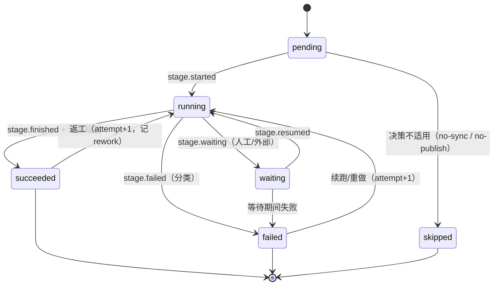
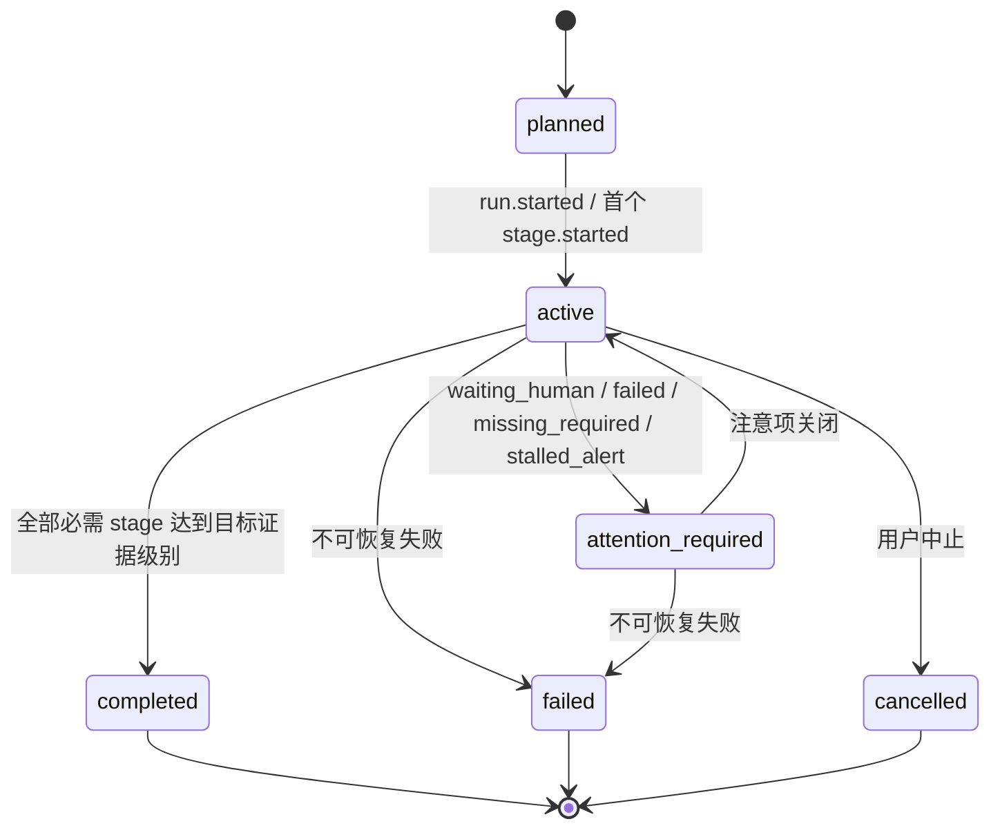
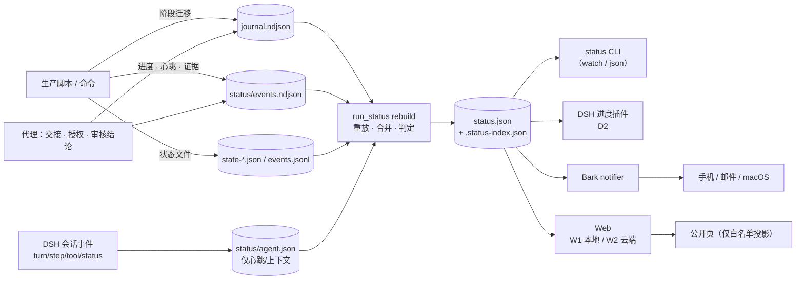

# 生产进度与状态显示：全链路状态模型与三种显示面

状态：**设计稿，2026-11-01。未实现、未接线、未部署。** 基线提交 `c7033cb2`（分支 `feat/sfa-week8-publish`）。本页只设计可观测性：不改变任何门禁、审核、哈希绑定、发布授权或流程顺序。**状态显示永远不是门禁**，不能替代人工整轨听审、发布 preflight、HTTP 读回、设备或现场验收；反过来，状态文件缺失也不能单独阻止生产，写入方必须 fail-open。

事实来源：2026-11-01 第 8 周实跑（`artifacts/`，已忽略 Git）、当前 checkout 的脚本与 `run_journal.summary` 实测输出、DSH 运行版 `0.2.1-rc.5` 与本机插件 `dsh-working-activity@0.6.0` / `dsh-notify-me@1.17.0` 的只读调研。调研笔记在 `tmp/progress-display/`（未入库）；DSH 版本在调研时同时存在运行版与可读源码两份，实现前必须以运行版为准。

相关文档：[逐句优先路线](../sentence-first-agent-production.zh.md)、[每周 runbook](../../experiments/sentence-first-agent/AGENTS.md)、[四层 Tracker](../four-layer-production-tracker.zh.md)与[公开 Tracker 页面](../../apps/tracker-web/README.zh.md)、[远程审核桥](../tracker-remote-review-bridge.zh.md)、[发布门禁](../sentence-first-agent-publish-gate.zh.md)、[少返工手册](../rework-avoidance.zh.md)、[Dev backlog](../backlog.zh.md)（`DEV-SF-007` 已登记"人审等待未打点"）。

## 先读：五条结论

1. **根因不是"没有显示"，而是"没有可显示的状态"**。逐句流程只有 7 个脚本写 `journal.ndjson`；翻译子代理、TTS 队列、人工听审、发布、学习内容、收尾全部没有打点。第 8 周三语 journal 的 `waiting` 事件为 **0**，`timings.tsv` 的 `waitingSeconds` 全为 `0.0`。
2. **先立一份事件协议和一份派生快照，再谈显示面**。DSH 插件、Bark、Web 页都只是快照的消费者；任何显示面都无法凭空知道"第几批、是否卡住"。
3. **三个显示面分工不同**：DSH 插件是**桌面驾驶舱**（实时细节），Bark 是**传呼机**（阶段里程碑、需要人工、停滞、失败），Web 页是**档案与远程视图**（历史、多 run、离开电脑后回看）。不要用一个替代另一个，也不要在协议未立时同时铺三个面。
4. **如果只能先做一件事：做 P0（状态协议 + `run_status` CLI + 现有事件/文件派生）**。它同时喂饱三个面。如果只能先做一个显示面：Bark 最快缓解"离开就瞎"；但"在 DSH 里看进度"只能靠插件。
5. **不新增第三套正式状态账本**。四层线继续用自己的 `sermon-four-layer-progress-v1`；逐句线新增的是**运行级可观测快照**。词表借鉴 `sermon-run-progress-v1` 已经区分开的"已处理／机器复核／人审／准入"，不合并账本、不互相冒充。

## 一、问题、证据与边界

### 1.1 用户实际要回答的七个问题

| # | 问题 | 今天能回答吗 | 需要的最小状态 |
|---|---|---|---|
| 1 | 现在跑到哪一步？ | 大多数时候不能 | 当前 phase / stage / lane + 进度计数 |
| 2 | 还在动吗？ | 不能 | 最后心跳时间、心跳年龄、吞吐 |
| 3 | 是不是卡住了？ | 不能 | 心跳期望 + 停滞判定（派生，不自动失败） |
| 4 | 需不需要我？ | 依赖代理主动说；消息沉底后不可见 | attention 队列：谁在等谁、等了多久、下一步动作 |
| 5 | 还要多久？ | 只能靠人读 run.md 和直觉 | 有样本的 stage ETA + 人工等待显式标记为未知 |
| 6 | 失败了吗？怎么续？ | 失败可见，续跑点不可见 | 失败分类 + 可续跑命令 + 是否 blocked |
| 7 | "完成"到什么程度？ | "完成"含义混杂 | 证据分级：产物／机器门禁／人审／已发布／HTTP 核验／设备 |

### 1.2 今天的证据

**打点覆盖极低。** 对当前 checkout 的穷举结果：

| 已写 journal 的脚本 | 写入的 stage |
|---|---|
| `sfa.py` | `l1.start` |
| `preflight.py` | `l1.preflight` / `l1.preflight.setup` |
| `srt_normalize.py` | `l1.srt` |
| `consistency_check.py` | `l2.consistency` |
| `finish_run.py` | `l3.finish` |
| `lag_loop.py` | `l3.lag-loop.<locale>` |
| `asr_triage.py`（历史可选） | `l3.asr-triage` |

其余全部零 journal：`translate_parts.py`、`build_speech.py`、`spoken_forms.py`、`spark_queue.py`、`spark_session_job.py`、`repair_sentence.py`、`review_sheets.py`、`review_player.py`、`sfa_publish.py`、`build_study.py`、`publish_study.py`、`assign_speakers.py`、`prepare_clip.py`。

**四个硬事实：**

- **TTS 队列（最长、最贵的阶段）没有本地状态。** 进度只存在于远端 `tts/*.wav` 数、`tts-log.jsonl`、跑队列进程的 stdout（`spark_queue.py` 打印 `job … / locale done`）。本机不在 ssh 时，DSH 完全看不到"第几批、卡没卡"。
- **人工听审没有自动打点。** runbook 要求代理手打 `l3.review.<locale>` 的 `waiting` / `resumed`；第 8 周三语实测 `waiting` 事件为 0，最大的等待时间块在状态面等于空白。
- **发布没有 journal / outcome / timings。** 发布目录只有 `publish-intent.json`、`gate/live-gate.json`、`http-verification.json` 等结果文件；`sfa_publish.py` grep `runlog` 零命中，与 runbook 中"发布型子命令写 outcome/timings"的描述不一致（这是文档与实现的漂移，已登记）。
- **`l3.lag-loop` 只写 `started` 不写 `finished`。** 第 8 周 zh 的 summary 永久显示 `status=running`，ko/es 没有该 stage，尽管两者 `sync: true`、runbook 要求 `gate.clean=true`。

**DSH 侧也不是"没能力"，而是"语义错位"：**

- `⏵` 状态行不是 UI 事件，是已安装的 `dsh-working-activity` 注入的一段系统提示词（其 `src/lang.ts:41-42`），由模型自己写文本；它不可解析、没有百分比、没有 ETA。
- `dsh-working-activity@0.6.0` 已实现 `waiting → thinking → tool → done` 四相 + 真实工具名 + 耗时，并通过 session projection 实时推送到 Web/Desktop；但它不知道 Layer 1–4、逐组或逐句进度。
- `dsh-notify-me@1.17.0` 已能把"需要你操作／回复完成"外发到 Bark 等通道；它**没有**"生产阶段里程碑"的概念，不能替代生产侧通知。
- DSH 没有名为 status line 的槽位；可用座位是 `conversation.input.dock`（工作行所在地）、`conversation-todo-dock`、`conversation.chat.node`、`tool.call.toolview`。运行版另有 `conversation.input.activity`（推断更像进度座位，未实测）。
- DSH 会话事件面足够判断"代理是否在动"：`turn/start`、`step/start`、`tool/call`、`tool/result`、`agent/status`、后台 job 生命周期等；但**业务语义必须由生产流程自己上报**。

### 1.3 目标与非目标

**目标：**

1. 任何时刻能回答 1.1 的七个问题，且答案有证据、有来源、有新鲜度。
2. 覆盖从任务开始、分阶段、等待人工、完成到失败的全链路；失败时给续跑点，不只给红叉。
3. 三种显示面共用一份协议，不各自造状态、不重复猜。
4. 状态写入对生产零阻塞：状态失败不影响步骤退出码，不写入密钥、正文或私有媒体。

**非目标：**

- 不做调度器、不做重试器、不改变任何门禁；状态不授予发布资格。
- 不把 `run.md`、journal 的 `note` / `refs`、`state-*.json` 的 `lastError`、模型名、本机路径公开到任何云端或手机。
- 不复制四层 Tracker 的账本；也不把逐句线的状态混入四层 Tracker 的 `sermonTrackerRuns` 正式记录。
- 不在本设计里实现代码、安装插件、部署页面或发送推送。

### 1.4 设计原则

1. **事件优先，快照派生。** 事件只追加；快照可从事件重建（像 `state_check.py` 对 DeepSeek state 做的那样）。
2. **状态不是门禁。** 失败/停滞只是注意项；放行仍由现有 validator、preflight、收据和人工决定。
3. **fail-open。** 状态写入、通知、插件读取任何一步出错都只记录警告，不改生产命令的退出码。
4. **来源与置信度可见。** 显式脚本事件 > 从状态文件派生 > 代理手打 > DSH 推断；冲突不静默覆盖，显示 `source` 徽章。
5. **先回答"卡住"，再回答"多久"。** 心跳年龄是一等字段；ETA 没有样本就显示未知，不编造完成时刻。
6. **证据分级。** "完成"必须说明到哪一级：产物、机器门禁、人审、已发布、HTTP 核验、设备/现场。
7. **一次写入，多处消费。** 生产脚本写；CLI、插件、Bark、Web 只读。

## 二、可复用资产与缺口

### 2.1 可复用资产

| 资产 | 位置 | 用途 | 注意 |
|---|---|---|---|
| 通用 stage 日志 | [`tools/development/run_journal.py`](../../tools/development/run_journal.py) | 阶段迁移（started/finished/failed/waiting/resumed）、compute/waiting/rework 汇总、`hostId` 脱敏 | 不改格式；高频率进度不要写这里 |
| 逐句 stage 词表 | [`experiments/sentence-first-agent/runlog.py`](../../experiments/sentence-first-agent/runlog.py) | 现有 stage 命名与 outcome/timings 派生 | 词表在 docstring 里，建议提升为机读注册表 |
| DeepSeek 三件套 | `coherence_core.py` → `state-<label>.json` / `events.jsonl` / `done.jsonl` / `units.jsonl` | 唯一的句级覆盖来源；state 可由事件流重建 | 已处理 `total=0`、`done>total`、永久 `running` 的边界 |
| 一致性检查 | `state_check.py` | 重放比对、缺失句、失败句、`state-check.json` | 天然适合作为公开/推送的脱敏汇总 |
| 发布门禁结果 | `gate/live-gate.json`、`http-verification.json`、`publish-intent.json` | 发布阶段的证据 | 只能到文件级；没有时长与重试 |
| 公开投影与新鲜度 | [`apps/tracker-web`](../../apps/tracker-web/README.zh.md)、`packages/tracker-contract/src/sanitize.mjs`、`infra/firebase/tracker/firestore.rules` | 白名单脱敏、120 秒过期、快照不回推时间 | 只借鉴模式，不复用四层账本语义 |
| Bark 客户端 | [`tools/ops/drive_upload_watch.py`](../../tools/ops/drive_upload_watch.py) 的 `Message` / `Notifier` | 多设备扇出、3 次退避、macOS 兜底、邮件兜底、四个 level | 仍是私有类，未抽成通用模块；group/服务名是上传监控专用 |
| DSH 现有插件 | `dsh-working-activity`、`dsh-notify-me` | 代理活动四相、会话级通知 | 不提供生产阶段语义；Bark 外发只覆盖"需要你／回复完成" |

### 2.2 缺口（按对"是否卡住"的影响排序）

| # | 缺口 | 影响 |
|---|---|---|
| G1 | TTS 队列无本地状态 | 最长阶段不可见；无法判断第几批、是否卡住 |
| G2 | 人工听审靠手打 `waiting`，实测 0 条 | 最大等待块不可见，被算成空白或计算时间 |
| G3 | 发布 14 个子命令无 journal | 发布过程黑盒；只能看结果文件 |
| G4 | 翻译子代理路线无进度 | 只有 4 个 output 文件级采样点 |
| G5 | `l3.lag-loop` 只写 started | 同步闸门是否通过不可判 |
| G6 | `l3.finish` 内部 5 个子步骤无子 stage | 5 分钟级黑盒 |
| G7 | 没有 run 级心跳/时效判定 | `openStages` 不能区分"在跑"与"死了" |
| G8 | `outcome.json` 粒度错位 | 是最后一次 `finish_run.py` 的起止，不是整 run |
| G9 | `started` 可无限重复 | 只见 start 不见 end 时会误判为运行中 |

**结论：** 显示面不是当前瓶颈；**状态语义、心跳和覆盖**才是。先把 G1–G3 补上，三个面才都有内容可显示。

## 三、全链路状态模型

### 3.1 实体与层级

```text
Production（一次周更 / 一个 pageId）
├─ Run（每个 locale 一个 run 目录；发布可另有一个 <run>-publish 目录）
│  ├─ Phase（P0 决策与预检 / P1 来源 / P2 文字 / P3 音频 / P4 人工听审 / P5 发布 / P6 收尾）
│  │  └─ Stage（原子步骤，例如 l2.translate.ko、l3.tts.john_thomas.zh-Hans、l4.publish.2）
│  │     ├─ Lane（locale 或 speaker；用于矩阵与队列视图）
│  │     ├─ Attempt（第几次尝试；重做/重跑）
│  │     └─ Unit（sentences / windows / batches / subcommands；可缺 total）
│  └─ Evidence（产物哈希、机器门禁、人审收据、部署、HTTP、设备）
└─ Attention（谁在等谁：人工听审、发布授权、决策、缺失必需阶段、停滞、失败）
```

**标识规则：**

- `productionId`：有正式页面时用 `pageId`；没有页面时用第一个 run 目录名。`decisions.json` 记录 form / locales / sync / publish / title / window，是 production 的冻结决策。
- `runId`：locale run 目录名，例如 `20261101-jesus-marks-zh`。
- `stageId`：沿用 `runlog.py` 的命名，附加缺失步骤；格式 `层.动作[.lane]`，只使用字母数字、`.`、`_`、`:`、`-`，满足 `run_journal` 的 128 字符约束。
- `lane`：locale（`zh-Hans` / `ko` / `es`）或 speaker key；同一 stage 可有多 lane。
- 新 stage 只做**加法**；旧名字保留，状态模块按前缀归一化（例如 `l3.finish` 从 run 目录推断 locale；未来可写 `l3.finish.zh-Hans`）。不改 journal 格式，不改既有脚本退出码。

### 3.2 Stage 状态机



- **`stalled` 不是存储状态**，而是由 `running` + 心跳年龄超阈值派生；不能自动改成 `failed`。
- `waiting` 必须带 `waitingOn`（人、服务、凭据）与 `kind`（`human` / `external`）；等待期间不算计算时间。
- `succeeded` 必须携带证据级别（见 3.7）；只写 finished 不等于可发布。
- `skipped` 只能由决策推导（例如不同步跳过 lag-loop、不发布跳过 L4），不能由"没看到"推导。

### 3.3 Production / Run 状态机



- `attention_required` 是**派生聚合状态**，不是新事实：任一打开中的 attention 项即触发。
- `completed` 只表示"必需阶段达到目标证据"，**不等于已发布**；发布、HTTP、设备、现场分别有独立证据级别。
- `stalled` 是 flag，不改变 run 状态；一个 run 可以既 `active` 又 `stalled=true`。

### 3.3.1 一条典型生产的推进

| 时点 | 发生什么 | 状态变化 | 用户可见信号 |
|---|---|---|---|
| T0 决策落盘 | `decisions.json` 写入；计算期望阶段集 | `planned → active` | 计划/开工通知（passive） |
| L1 来源 | 裁切、preflight、英文表、讲员映射 | `l1.*`；人工确认开 attention | 英文表/映射可审通知 |
| L2 文字 | 每 locale 翻译 → 独立审计 → 一致性 | `l2.*` 并行；`attention=0` | 每语文字完成（可选，不吵） |
| L3 音频 | 口播规格 → TTS 队列 → finish → lag-loop | `l3.*`；GPU 队列串行 | TTS 每批进度；lag gate 通过/失败 |
| 人工听审 | 可审后 `handoff` → `waiting` | `attention_required` | 每语可审通知 + 等待年龄；收据后关闭 |
| L4 发布 | assets → gate → publish → verify → readback → english-reference | `l4.*`；每个子命令 E1→E4→E5 | 发布进度/完成通知；证据级别 |
| 收尾 | 报告、PR、commit；`run.finished` | `completed` | 完成通知 + 每种交付物的证据级别 |
| 任意失败 | `stage.failed` + 分类 | `attention_required` 或 `failed` | 失败通知 + 续跑命令 |
| 任意卡住 | 心跳超阈值 | `stalled=true`（不改变 run 状态） | 停滞通知（冷却，不自动重启） |

### 3.4 事件协议

**两类日志，职责分开：**

| 文件 | 内容 | 频率 | 写入方 |
|---|---|---|---|
| `<run>/journal.ndjson` | 阶段迁移（started/finished/failed/waiting/resumed）+ 成本 | 每阶段几次 | 现有脚本/代理 |
| `<run>/status/events.ndjson` | 高频进度、心跳、attention 开关、证据记录、来源 | 每批/每 15–60 秒 | 脚本、包装器、代理 |
| `<run>/status/agent.json` | DSH 代理活动心跳与工具上下文（非业务事实） | 每 15–30 秒 | DSH 插件（host 半） |
| `<run>/status/status.json` | 派生快照（原子替换） | 每次 rebuild | `run_status` |
| `<run>/status/notify-sent.ndjson` | 通知去重账本 | 每条通知 | notifier |

**事件信封（`sentence-first-status-event-v1`）：**

```json
{
  "schemaVersion": "sentence-first-status-event-v1",
  "eventId": "20261101-jesus-marks-zh:9f3a1c2e",
  "at": "2026-11-01T15:04:05-07:00",
  "productionId": "jesus-marks-20261101",
  "runId": "20261101-jesus-marks-zh",
  "stage": "l3.tts.john_thomas.zh-Hans",
  "lane": "zh-Hans",
  "attempt": 1,
  "type": "stage.progress",
  "source": "script:spark_queue.py",
  "progress": {"unit": "sentences", "done": 312, "total": 418},
  "etaSeconds": 540,
  "message": "batch 39/52",
  "severity": "info"
}
```

事件类型：

| 类型 | 用途 | 必填 |
|---|---|---|
| `run.planned` | 决策已落盘、期望阶段集已计算 | productionId, decisionsSha256 |
| `run.started` / `run.finished` / `run.failed` / `run.cancelled` | run 生命周期 | runId, at |
| `stage.started` / `stage.finished` / `stage.failed` / `stage.skipped` | 阶段迁移（可同时写 journal） | stage, attempt |
| `stage.progress` | 计数/吞吐/ETA | progress 或 etaSeconds |
| `stage.heartbeat` | 存活信号；可与 progress 合并 | stage, at |
| `stage.waiting` / `stage.resumed` | 等待人工/外部 | waitingOn, kind |
| `attention.open` / `attention.close` | 需要人处理的事项 | attentionId, kind, severity |
| `evidence.recorded` | 产物/门禁/人审/部署/HTTP/设备证据 | level, ref, sha256? |
| `stage.rework` | 重复启动的显式标记 | attempt, previousFinishedAt |

**写入规则：**

- 只追加，不原地改历史；同一事件重放必须幂等（用 `eventId` 去重）。
- 单条 JSON 行；`O_APPEND`；`status.json` 用 `tmp + os.replace` 原子替换。
- 不写密钥、字幕正文、翻译正文、私有媒体、绝对路径；`message` 只放短机器可读片段（批次、计数、错误码），公开投影会丢弃自由文本。
- 状态写入失败只记警告（fail-open）；不改变生产命令退出码。
- 事件排序用 `(at, eventId)`；不依赖跨进程全局 seq。

### 3.5 快照协议（`sentence-first-run-status-v1`）

每次 rebuild 从 journal + status events + `state-*.json` + `agent.json` + 已知收据/结果文件重放生成。最小字段：

```json
{
  "schemaVersion": "sentence-first-run-status-v1",
  "productionId": "jesus-marks-20261101",
  "runId": "20261101-jesus-marks-zh",
  "locale": "zh-Hans",
  "generatedAt": "2026-11-01T15:05:00-07:00",
  "runState": "active",
  "stalled": false,
  "freshness": {"ageSeconds": 8, "heartbeatAgeSeconds": 8, "state": "fresh"},
  "source": {"journalEvents": 24, "statusEvents": 61, "derived": ["state-trim.json"], "index": "artifacts/sentence-first-agent/.status-index.json"},
  "stages": [{
    "id": "l3.tts.john_thomas.zh-Hans",
    "phase": "P3",
    "lane": "zh-Hans",
    "state": "running",
    "attempt": 1,
    "startedAt": "2026-11-01T14:52:00-07:00",
    "progress": {"unit": "sentences", "done": 312, "total": 418},
    "heartbeat": {"at": "2026-11-01T15:04:57-07:00", "expectedSeconds": 180, "ageSeconds": 8},
    "eta": {"seconds": 540, "source": "observed", "samples": 12, "low": 420, "high": 720},
    "evidenceLevel": "E1",
    "source": "script:spark_queue.py"
  }],
  "attention": [{
    "id": "att-20261101-zh-review",
    "kind": "human_review",
    "stage": "l3.review.zh-Hans",
    "since": "2026-11-01T15:10:00-07:00",
    "waitingOn": "user track review",
    "actionUrl": "http://127.0.0.1:8765/review-player.html",
    "expectedMinutes": "20-80",
    "severity": "timeSensitive"
  }],
  "deliverables": [{"id": "track.zh-Hans", "evidenceLevel": "E1", "ref": "track.wav"}],
  "required": {"missing": [], "notDue": ["l3.lag-loop.ko"]},
  "projection": {"rebuildSeconds": 0.03, "redacted": false}
}
```

**Production 聚合：** `artifacts/sentence-first-agent/.status-index.json` 列出活跃 production 与各 locale run 目录（由 `sfa.py start` / `run_status register` 写）；`run_status production --production <id>` 把各 run 快照合并为 `.status/<productionId>.json`。聚合不复制原始事实，只合并 stage 列表与 attention；冲突按 3.11 的来源优先级裁决，并在快照里标 `source`。

### 3.6 心跳、停滞与新鲜度

| 阶段类型 | 期望心跳 | 停滞阈值（建议） | 依据 |
|---|---|---|---|
| DeepSeek 翻译/审计 | 120 秒（每次调用写 state/events） | 3× 期望；6× 发 alert | `state-*.json` 每窗口更新；`events.jsonl` 每次调用一行 |
| TTS 队列 | 180 秒（每 batch 一次；用 `tts-log.jsonl` 实测中位数校准） | 3× / 6× | 每 batch 写 `tts-log.jsonl` / `tts-batches.jsonl` |
| `finish_run.py` | 60 秒（拉回、合并、MP3、预览、排程五个子步骤） | 3× / 6× | 现在无子 stage；需新增进度写入 |
| 发布子命令 | 120 秒 | 3× / 6× | 14 个子命令逐个黑盒 |
| 人工听审 | 无心跳 | 用等待年龄 + 计划时间；超过计划 2× 标 overdue | 不能把"没动"当停滞 |
| 代理思考/工具之间 | 90 秒（DSH `session/event` 活动） | 3× 只作提示 | DSH 有事件面；但没有业务语义 |

**规则：**

- `stalled = (now - lastHeartbeatAt) > max(3 × expectedSeconds, 120) && state == running`。
- 停滞是**提示**，不是失败：显示最后事件、最后心跳年龄、最后一行日志；给出检查命令（`ssh`/`ps`/`docker`/`spark_exclusive_session status`），不自动重启。
- 快照本身也有新鲜度：`freshness.ageSeconds > 120` 显示 `stale`（Tracker 的同款边界）；`stale` 只表示"这份状态旧了"，不表示任务失败。
- 页面/插件不得在客户端继续累加时间；所有时间以快照 `generatedAt` 为上限。这是 Tracker 已经验证过的原则。
- 等待人工不是停滞：`waiting` 只看等待年龄；若计划里写了预计审听时长，可以显示"已等 X / 预计 Y"，但不承诺。
- **独立探针（可选，不替代业务心跳）**：由 launchd 或后台进程每 30–60 秒检查活跃 stage 的 PID、SSH 可达性、容器/session 状态，把结果写 `status/probe.json`。它只回答"进程还在不在"，不产生业务进度；没有探针时，停滞只能靠最后心跳推断。
- **DSH 插件缺席不是停滞信号**：`agent.json` 缺失只表示没有 DSH 心跳；stage 停滞仍以 stage 自己的心跳为准。两者都缺失时显示 `liveness: unknown`，不能直接报"卡住"。

### 3.7 证据分级（诚实标签）

| 级别 | 含义 | 例子 | 谁能写 |
|---|---|---|---|
| E0 | 未开始/无证据 | 缺 preflight | 派生 |
| E1 | 产物已写出（含哈希） | `translations.jsonl`、`track.wav`、`speech.jsonl` | 脚本 |
| E2 | 机器门禁通过 | preflight、consistency、lag-loop `gate.clean`、发布 gate | 脚本/validator |
| E3 | 人工批准（收据） | 英文表批准、整轨听审收据、学习内容 `humanApproval` | 用户/代理落盘 |
| E4 | 已部署 | `publish` 成功 | 发布驱动 |
| E5 | HTTP 读回核验 | `verify` / `readback` / smoke | 发布驱动 |
| E6 | 设备/现场验收 | 手机播放、现场 | 人 |

- `stage.finished` 必须带 `evidenceLevel`；`l4.publish` 到 E4 不等于 E5，`human_reviewed` 只到 E3。
- `run.completed` 需要每个必需交付物达到目标级别；状态页并列显示"已发布（HTTP 已核验）／设备未验收"，不合并成一个绿勾。
- 机器复核不是人审：`revisions`、`audit`、`consistency` 都只能到 E2；只有用户收据到 E3。

### 3.8 失败、恢复与未知结果

| 分类 | 例子 | 状态建议 | 允许的恢复 | 通知 |
|---|---|---|---|---|
| `infra` | SSH/GPU/容器/网络 | failed，resumable | 续跑/失败转移（仅确认基础设施故障） | timeSensitive |
| `model` / `api` | 429、超时、校验失败 | failed，resumable | 限量修复/续跑；先对账 | active |
| `content` / `quality` | 译文/审计/闸门不通过 | failed，needs decision | 人工决定，不自动重试 | timeSensitive |
| `credential` / `authorization` | 缺 ADC、Firebase 登录、发布授权 | blocked | 等用户 | active |
| `unknown_outcome` | 付费调用已发出但结果未知 | blocked，停止新派发 | 先对账（不变式 5），不盲重试 | critical（需权限） |
| `cancelled` | 用户中止 | cancelled | 按新 run 身份重开 | passive |

- 每个失败事件带 `resume`：命令模板 + 前置条件 + 不会重做的部分（例如"重跑 `finish_run.py`；TTS 已完成句子会跳过"）。
- `unknown_outcome` 必须在状态页/Bark 最显眼位置，并显示"已暂停新付费派发"；不能只写"失败"。
- 失败后修复成功不是"没发生"：`attempt` 与 `reworkSeconds` 保留，复盘看得到。

### 3.9 人工等待与 attention

`waiting` 事件升级为 attention 项，是三个显示面共同的最小单位：

| 字段 | 说明 |
|---|---|
| `id` | `att-<production>-<kind>-<lane>` |
| `kind` | `human_review` / `authorization` / `decision` / `missing_required` / `stalled` / `failed` / `unknown_outcome` |
| `stage` / `lane` | 定位 |
| `since` | 开始等待时间；年龄由快照计算 |
| `waitingOn` | 人/服务/凭据 |
| `actionUrl` | 本地播放器、页面、发布授权位置 |
| `expectedMinutes` | 计划里的审听/操作预计；未知则不填 |
| `severity` | `info` / `attention` / `timeSensitive` / `critical` |
| `closeCondition` | 收据出现、授权完成、失败修复、人工关闭 |

**人工等待的自动化边界：**

- `finish_run.py` 生成 `review-player.html` + `review.mp3` 后只记 `review_prepared`（E1 产物），**不直接开 attention**：可审还要求 `l1.preflight`、`l2.consistency` 与（同步 run）`lag-loop` 的 `gate.clean=true`。代理确认这些 gate 后用 `run_status handoff` 开 `human_review` attention；收据 `sentence-first-human-review-verdict-v1` 出现（或代理确认）后关闭。这样不会在 lag-loop 未过或 gate 未齐时提前叫人。
- 发布授权同理：`preflight` 通过后开 `authorization` attention；用户授权后关闭。不要把"授权"写成计算时间。
- 等待年龄只增；快照更新不会重置；`resumed` 后进入 waitingSeconds，与 journal 的口径一致。

### 3.10 阶段清单与进度单位

下表把 runbook 的每周步骤映射到 stage。**加粗**为现有 journal 名字；其余为建议新增（加法，不破坏旧名）。

| 步骤 | stage | 进度单位 / 分母 | 心跳来源 | 今天覆盖 |
|---|---|---|---|---|
| 0.5 环境预检 | **`l1.start`**（含环境+准备） | 子步骤计数（git/env/run/spark/firebase） | 脚本 | 部分 |
| 0 决策 | `run.planned`（事件） | 决策项 | 代理 | 无 |
| 0.1 审听计划 | `l1.plan`（可选） | 无（计划文本） | 代理 | 无 |
| 1 Spark 会话 | `l1.spark-session` | begin/finish | 会话工具 | 无 |
| 2 裁切拆句 | `l1.prepare`（与 l1.start 合并可） | 单元数 / 句数 | 脚本 | 部分 |
| 2 分发三语 | `l1.share` | 每 locale 复制 | 脚本 | 无 |
| 3 讲员映射 | `l1.speakers` + `human_review` attention | 低一致度句数 | 脚本 + 代理 | 弱 |
| 英文表人审 | `l1.english-review` | 收据 | 代理 | 无 |
| 5 末 preflight | **`l1.preflight`** | 检查项 | 脚本 | 有 |
| 4 翻译 | `l2.translate.<locale>` | 句数 / 窗口数 | DeepSeek state / 子代理 output | 分叉：DeepSeek 弱有，子代理无 |
| 4 独立审计 | `l2.audit.<locale>` | 窗口数 / 句数 | DeepSeek events | 无 |
| 4 一致性 | **`l2.consistency`** | 问题数 | 脚本 | 有 |
| 5 口播规格 | `l3.speech.<locale>` | 句数 / 预算超额句数 | 脚本 | 无 |
| 6 TTS | **`l3.tts.<speaker>.<locale>`** | 句数 + batch 数 + 队列位置 | spark_queue / tts-log | 无（最大缺口） |
| 7 收尾合并 | **`l3.finish`**（建议加 locale） | 5 子步骤 | 脚本 | 有（内部黑盒） |
| 7 落后回环 | **`l3.lag-loop.<locale>`** | 轮次 + 超阈值句数 | 脚本 | 有 started，缺 finished |
| 8 人工听审 | **`l3.review.<locale>`** | 无百分比；等待年龄 | 代理/收据 | 规范有、实现 0 |
| 9 改句 | `l3.repair.<locale>` | 句数 | 脚本 | 弱 |
| 10 发布 | **`l4.assets`** / **`l4.publish.<n>`** | 子命令计数（14 步） | 发布驱动 | 无 |
| 10 发布门禁 | `l4.gate` | 94 项检查 | 脚本 | 结果有、过程无 |
| 10 英文对照 | `l4.english-reference` | 每 locale blocks | 发布驱动 | 无 |
| 10.5 学习内容 | `l4.study` | 大纲/默想/收据 | 脚本 | 无 |
| 11 收尾 | `l5.report` | 报告/PR/commit | 代理 | 无 |

**进度单位规则：**

- 有明确分母才显示百分比；`total=0` / 未知时显示 `unitsDone` + "分母未知"，不硬算。
- `done > total`（DeepSeek 重试）时以 `unitsDone` 对 `sentences.jsonl` 行数为准，百分比不进位。
- TTS 同时显示"句 / 批 / 队列位置"；队列位置来自 `spark_queue.py` 的 job 列表，跨 locale 才有意义。
- 发布按子命令计数，不按文件数；每个子命令有 started/finished 才能算。
- 人工阶段不显示百分比；只显示等待年龄与计划。

### 3.11 必需阶段与"静默跳过"检测

从 `decisions.json` 推导期望阶段集；`required` 规则示例：

| 条件 | 必需阶段 |
|---|---|
| 所有 run | `l1.start`、每 locale `l1.preflight`、`l2.translate`、`l2.audit`、`l2.consistency`、`l3.speech`、每 speaker `l3.tts`、`l3.finish`、`l5.report` |
| `sync: true` | 每 locale `l3.lag-loop` + `gate.clean`（E2） |
| `publish: true` | `l1.english-review`、每 locale `l3.review`（E3）、`l4.*`、`l4.english-reference`、`l4.gate`、`l4.verify`/`readback`（E5） |
| 有学习内容 | `l4.study`（E3 人审） |
| `form: clip` | 不要求整期覆盖；片段用连续子集检查 |

**检测规则：**

- 前驱 `finished` 后，在 grace（建议 10 分钟）内没有 `started` → `missing_required` attention。
- run 标记 `finished` 但必需阶段缺证据 → 快照 `runState=attention_required`，不显示"完成"。
- 已知事故要能被这张表直接抓到：2026-10-24 跳过独立审计、2026-10-22 漏部署英文对照、第 8 周 lag-loop 无 finished。状态只提示，不放行也不替代发布 gate。

### 3.12 存储布局与写入规则

```text
artifacts/sentence-first-agent/                 # 已忽略 Git
├─ .status-index.json                           # 活跃 production → run 目录
├─ .status/<productionId>.json                  # 聚合快照
├─ <locale-run>/
│  ├─ journal.ndjson                            # 现有，不改
│  └─ status/
│     ├─ events.ndjson                          # 进度/心跳/attention/证据
│     ├─ status.json                            # 派生快照（原子替换）
│     ├─ agent.json                             # DSH 插件心跳（非业务事实）
│     ├─ notify-sent.ndjson                     # 通知去重
│     └─ status-check.json                      # 重放一致性报告（可选）
└─ <pageId>-publish/status/...                  # 发布 run 同样适用
```

- `journal.ndjson` 保持唯一迁移事实源；`status/events.ndjson` 只放高频与派生状态，不重复迁移事件。
- 所有状态文件在 `artifacts/` 下，天然不进 Git；跨机读取不在本设计范围。
- 清理跟随 run 目录；`.status-index.json` 只保留活跃 production，旧的标记 `inactive` 不删除（复盘可查）。
- 公开投影不读 `journal.note` / `refs` / `pid` / `model` / 路径 / 错误原文；只读快照里显式白名单字段。

### 3.13 来源优先级与冲突

`explicit script event` > `derived from state files/artifacts` > `agent manual mark` > `DSH inferred`。

- 快照里每个 stage 带 `source`；冲突时不覆盖，标 `conflict: true` 并保留两个来源。
- DSH 推断只用于心跳/工具上下文，**永不**用于 stage 完成或进度分母。
- 代理手打只用于脚本确实无法推断的边界（听审交接、发布授权）；手打也必须带 `stage` + `event`，不能写自由文本完成。

## 四、三种显示面的评估

### 4.1 DSH 插件

**现状：**

- 已有 `dsh-working-activity@0.6.0`：四相（waiting/thinking/tool/done）+ 真实工具名 + 本地 tick 的耗时；通过 session projection 推送到 Web/Desktop。它显示"代理在干什么"，不显示"生产到哪一步"。
- 已有 `dsh-notify-me@1.17.0`：审批/方案/提问/回复完成的通知，可外发 Bark；没有阶段里程碑。
- `⏵` 是提示词契约（模型自由文本），不是结构化 UI；不要解析它做真相。
- 没有 status line 槽位；可用座位是 `conversation.input.dock`、`conversation-todo-dock`、`conversation.chat.node`、`tool.call.toolview`；运行版另有 `conversation.input.activity`（推断）。

**四种做法：**

| 方案 | 做什么 | 工作量 | 优点 | 限制 |
|---|---|---|---|---|
| D0 配置 + 提示词 | 给 `dsh-working-activity` 配 `customActions`（脚本名 → "配音排队/合并/发布"），并在 runbook 里把 `⏵` 约定成"阶段 + i/n" | S（小时级） | 零代码、立即改善 | 仍是自由文本；无百分比/ETA/停滞判定 |
| D1 fork working-activity | 复用其 projection + client 骨架，换成生产阶段词表 | M（300–500 行） | 与现有状态行一体 | 维护 fork；版本漂移风险；projection 只折叠 session 事件，仍需要业务上报 |
| **D2 独立轻插件（推荐）** | host 读 `.status-index.json` / `status.json`，监听 DSH 会话事件做心跳；client 在 `conversation.input.dock` 渲染阶段、i/n、心跳年龄、attention 徽章；可展开面板 | M（1–2 天） | 不写 session 日志、不 fork；状态文件是唯一事实；失败不影响生产 | 只在 DSH 打开时可见；插件无沙箱、需信任；需跟 DSH 0.2.x 版本 |
| D3 上游能力 | 给 DSH 提议通用 progress/status 原语 | L | 长期最干净 | 不在本项目控制范围 |

**推荐：D0 立即做 + D2 作为 MVP。** 不推荐先 fork（版本已三份并存：运行 asar `0.2.1-rc.5`、可读源码 `0.1.0-rc.5`、插件 target 0.2.x）。D2 的边界要写清：

- **能显示**：当前阶段/车道、句/批进度、心跳年龄、ETA（有样本时）、队列位置、attention、最近 5 条事件；点开可看 phase 列表与链接。
- **不能显示**：脚本没上报的业务真相；DSH 关闭后的状态；把"代理在想"误当生产进度。
- **不写** session 日志（第三方插件写自定义事件会破坏会话可恢复性）；只写 `status/agent.json` 与读快照。
- 安装即全权限（无沙箱），必须本地代码评审后再装；插件落点建议 `tools/ops/dsh-production-progress/`（Node 包），不混入生产 Python 包。

### 4.2 Bark 推送

**已有能力：** `drive_upload_watch.py` 的 `Message` / `Notifier` 已实现 `POST https://api.day.app/push`、多设备扇出、3 次指数退避、`passive|active|timeSensitive|critical`、`bark-mac` 失败转 macOS 本地通知、非 passive 邮件兜底；key 在登录钥匙串，不进 URL/日志/仓库。生产线上目前一步都不发。

**适合：**

- 阶段里程碑：开工、英文表可审、每条语言轨可审、页面发布、run 完成。
- 需要人工：听审交接、发布授权、决策确认。
- 异常：停滞超过阈值、失败、未知结果（停止新派发）。
- 携带深链：状态页/本地播放器/正式页面（按受众决定）。

**不适合：**

- 实时连续进度（通知中心不是仪表盘）；逐句/逐批推送会造成通知疲劳。
- 需要回看/历史/多 run 对比（Bark 无状态）。
- 送达确认（`code=200` 是 Bark 接收，不等于手机展示或用户阅读）。

**通知策略建议（每次 run ≤ 8 条）：**

| 事件 | 级别 | 去重键 | 正文要点 |
|---|---|---|---|
| 开工/计划 | `passive` | `run:start` | 语言、形态、同步/发布、首个可审预计 |
| 英文表/讲员映射可审 | `active` | `att:english-review` | 链接 + 审什么 + 预计 |
| 每语轨可审 | `active` | `att:review:<locale>` | 轨长 + 先听标记 + 播放器 |
| lag gate 失败/发布门禁失败 | `timeSensitive` | `fail:<stage>:<attempt>` | 失败分类 + 续跑命令 |
| 停滞 | `timeSensitive`（首次） | `stall:<stage>` | 最后心跳/批次 + 检查命令；冷却 15 分钟 |
| 未知结果 | `critical`（需权限） | `unknown:<stage>` | 已停止新派发，先对账 |
| 发布完成 | `active` | `run:published` | 页面 URL + HTTP 核验状态；设备未验收另说 |
| run 完成 | `active` | `run:finished` | 三语链接 + 证据级别 |

- 复用现有 `Notifier` 时抽成 `tools/ops/notify.py`；新 group `sermon-production`，新钥匙串服务 `org.sermonvideo.production-progress`（key 需用户先存；不把现有网盘监控的 key 静默混用）。
- `critical` 依赖手机「重要警告」权限；首次上线必须 `test-push --critical` 真机确认，收不到退回 `timeSensitive`。
- 与 `dsh-notify-me` 的关系：保留它做 DSH 会话级提醒；生产通知由 `run_status` 统一发，避免同一次等待被两个通道重复推送。

### 4.3 Web 进度页

**已有先例：** `apps/tracker-web` 就是 `https://ai-for-god-sermon-tracker-dev.web.app` 的源码：Vite + Firebase Web SDK，读 Firestore 命名库 `sermon-tracker` 的 `sermonTrackerRuns`，匿名只读、客户端零写；前端有 120 秒快照过期、白名单 sanitizer、相对时间线、条件 ETA。它证明这条路可行，但它显示的是**四层周更检查点**，不是逐句流程的批次/队列。

**两个变体：**

| 变体 | 做法 | 优点 | 限制 | 建议 |
|---|---|---|---|---|
| W1 本地状态页（先做） | 静态 `status.html` + 读 `status/status.json`；用现有 `python -m http.server -d $RUN 8765` 与播放器同源（或独立端口）；局域网可看 | 零云资源、零鉴权、隐私最好、半天可做；可显示阶段矩阵/时间线/attention | 只在 Mac 醒着时可用；不能远程；无历史（只有当前快照） | **P4a，值得做** |
| W2 云端进度页（后置） | 本地 publisher 读快照 → 白名单投影 → Firestore（新集合或新 doc）→ 复用 Tracker 前端或新小站 | 远程/手机可看；历史/多 run；可做审阅交接 | 新增 publisher、schema、页面、部署授权；公开站必须走 sanitizer；CSP/鉴权/成本 | **仅当远程/历史成为真实需求再做** |

**对旧 Tracker 的复用判断：**

- 可复用：白名单投影、120 秒新鲜度、相对时间线、"快照不前进就不推进时间"、只读规则、发布器心跳模式。
- 不复用：`sermonTrackerRuns` 的正式四层语义、`pageId × layer × locale` 检查点、正式发布计数；逐句线需要 `run × stage × lane` 与批次/队列字段。混用会让公开页同时出现两套"完成"口径。
- 若做 W2：另建集合（例如 `productionRunStatus`）或独立 site；新字段必须先加 sanitizer 白名单；不得放 `note`/`refs`/`model`/`lastError`/路径/哈希；页面必须显示 snapshot 时间与 publisher 心跳；不能根据"最后一条状态"推断在线。

**CSP 提醒：** 周更站 `default-src 'self'`、`connect-src 'self'`，不能挂跨源轮询；Tracker 站只允许 Firestore；`tongxing-diagrams-dev` 允许 inline 但自述"仅承载静态图，不放用户输入或内容包"，不要把运行时进度塞进去。

### 4.4 对比矩阵

| 维度 | DSH 插件 | Bark 推送 | W1 本地页 | W2 云端页 |
|---|---|---|---|---|
| 桌前实时细节 | 强（阶段/i-n/心跳） | 弱（只有推送） | 中（刷新/轮询） | 中 |
| 离开电脑 | 弱（应用关了就没了） | 强（手机） | 弱（局域网/需醒着） | 强 |
| 判断"卡住" | 强（心跳年龄） | 中（只收到告警，不能查） | 中 | 中 |
| 需要人工的提醒 | 中（看着才有用） | 强 | 中 | 中 |
| 历史/多 run | 弱 | 弱 | 中（仅当前） | 强 |
| 失败与续跑点 | 中 | 中（正文可带命令） | 中 | 中 |
| 部署/接入成本 | M（插件开发+安装） | S（复用 Notifier） | S | L |
| 维护成本 | M（DSH 版本耦合） | S | S | L（publisher/schema/页面） |
| 隐私风险 | 低（本地） | 中（第三方服务器收到标题/正文） | 低（本地） | 中/高（公开站需白名单） |
| 依赖状态协议 | 高 | 高 | 高 | 高 |

### 4.5 组合建议

```text
P0 状态协议 + run_status CLI（所有面的共同底座）
├─ P1 DSH 插件：桌前驾驶舱（实时阶段/i-n/心跳）
├─ P2 Bark：传呼机（里程碑/需要人工/停滞/失败/未知结果）
├─ P3 W1 本地状态页：回看与当面共享
└─ P4 W2 云端页：仅当远程/历史成为真实需求（后置）
```

- **推荐组合：P1 + P2 为核心，P3 可选，P4 后置。** P1 回答"现在到哪"，P2 回答"要不要回来"，P3 回答"刚才发生了什么"，P4 回答"离开后/多人看"。
- **如果只能先做一个显示面：** 先 P2 Bark（最快缓解"离开就瞎"），但明确它不能替代桌面进度；下一轮补 P1。
- **如果只能先做一件事：** 做 P0。没有协议，三个面都只能猜；P0 的 CLI 本身就能用（终端 `watch`）。
- **不要同时铺三个面。** 它们不修复覆盖缺口，只会把同一份不完整状态渲染三次，增加维护与误报。

## 五、推荐架构



**组件职责：**

| 组件 | 职责 | 不做什么 |
|---|---|---|
| 生产脚本 | 写 journal 迁移 + 高频进度；状态写入 fail-open | 不决定门禁；不写正文/路径/密钥 |
| 代理 | 写无法自动推断的边界（听审交接、授权、决策）；维护 `run.md` 叙述 | 不把自由文本当状态；不手改快照 |
| `run_status` | 追加事件、重放快照、停滞/ETA/注意力判定、CLI | 不调度、不重试、不部署 |
| DSH 插件 | 读快照 + DSH 活动心跳，渲染 dock 面板 | 不写业务真相；不写 session 日志 |
| notifier | 按策略/去重/level 发 Bark + 兜底 | 不逐句推送；不把送达当阅读 |
| Web | 读快照渲染；公开页走白名单投影 | 不客户端外推时间；不混四层账本 |

**写路径顺序（建议实现顺序）：**

1. `run_status register` 写 `.status-index.json`（`sfa.py start` 调用）。
2. 每个长命令用 `run_status wrap --stage ... -- <command>`：自动 started/finished/failed + 每 15 秒心跳；可解析 stdout 的进度行（TTS/发布）。
3. 脚本内部在关键批次/子步骤直接写 `stage.progress`（优先 TTS、finish、publish）。
4. 代理在交接/授权时 `run_status handoff` / `run_status resume`。
5. `run_status rebuild` 由写事件触发或定时（2–5 秒防抖），原子替换快照。
6. `run_status notify` 读快照 + 去重账本发 Bark；失败只告警。

**与现有流程的关系：**

- `journal.ndjson` 仍是复盘/导出/`timings.tsv` 的唯一迁移源；状态模块只读它，不替换。
- `state_check.py` 继续负责 DeepSeek 阶段一致性；`run_status` 可以调用它并把结果并入快照。
- `outcome.json` / `timings.tsv` 仍在收尾时生成；状态快照不替代运行报告。

## 六、实施计划

**P0｜状态协议与 CLI（M，约 2–3 天）**

- 新增 `experiments/sentence-first-agent/run_status.py`（stdlib；复用 `run_journal` / `runlog`），stage 注册表与 schema 放 `schemas/` 或同目录 JSON。
- 子命令：`register` / `mark` / `wrap` / `handoff` / `resume` / `rebuild` / `status [--watch] [--json]` / `production` / `notify` / `check`。
- 从现有 journal + `state-*.json` + 收据/结果文件派生快照；不要求先改所有脚本。
- 单测：事件重放、`total=0`/`done>total`、start 无 end、停滞阈值、缺失必需阶段、快照原子性。
- 验收：任意现有 run 能生成快照；`status --watch` 可读；`check` 重放一致；状态写入失败不影响命令退出码。

**P1｜覆盖接入（M，约 2–4 天）**

- 优先：`spark_queue.py`（每 batch 写进度/队列位置/内存）、`finish_run.py`（5 子步骤）、`lag_loop.py`（保证 finished/failed）、`sfa_publish.py`（每个子命令）、`translate_parts.py`（每份 output）。
- 其次：`build_speech.py`、`assign_speakers.py`、`repair_sentence.py`、`review_sheets.py`、`build_study.py`/`publish_study.py`。
- 代理边界：听审交接 `handoff`、收据 `resume`、发布授权；runbook 增加一条"这些动作必须打点"。
- 验收：3.10 表中每个必需步骤至少有 started/finished 或可派生状态；第 8 周同类 run 的 `waiting` 不再为 0。

**P2｜Bark 通知（S，约 0.5–1 天）**

- 从 `drive_upload_watch.py` 抽 `Message` / `Notifier` 到 `tools/ops/notify.py`（保持依赖注入），原 watcher 改为 import；新增测试。
- 新 group/钥匙串服务；用户存 key；`test-push` 真机确认（含 `critical` 降级）。
- 策略/去重/冷却/静默时段；通知内容模板；`notify-sent.ndjson`。
- 验收：一次真实/演练 run 的通知数 ≤ 8、无重复；停滞/失败/未知结果能在 2 分钟内到手机；所有消息不含正文/路径/密钥。

**P3｜DSH 插件（D0 小时级；D2 M，约 1–2 天）**

- D0：`dsh-working-activity` 的 `customActions` 映射脚本名；runbook 的 `⏵` 约定加阶段与 i/n。
- D2：`tools/ops/dsh-production-progress/`（Node 包）；host 读 index/status、监听 session 事件；client 注册 `conversation.input.dock`；面板含阶段条、心跳年龄、attention、最近事件；安装到 desktop profile。
- 验收：真实 run 中状态变化 2 秒内可见；DSH 重启/插件卸载不影响生产；插件不可用时 CLI/Bark 仍工作。

**P4｜Web（W1 S；W2 后置）**

- W1：静态页 + `status.json`；与播放器同源或独立端口；显示快照年龄；局域网可选。
- W2：仅当出现"远程看/多人看/跨 run 历史"的真实需求；复用 Tracker 的 sanitizer/publisher/新鲜度模式；新集合或新 site；单独授权部署。
- 验收：W1 不引入云资源、不暴露路径；W2 过 sanitizer 白名单审计、快照过期可见。

**依赖与顺序：** P1 依赖 P0；P2/P3 依赖 P0（P2 可先用 journal 派生）；P4 依赖 P0，W2 依赖 P2/P3 的价值验证。任何阶段都不阻塞生产；状态模块可随时停用。

**不建议的顺序：** 先做 Web 或先做插件、后补协议；先公开云端页再补隐私投影；先接 Bark 逐批推送。

## 七、验收标准

| 场景 | 期望 |
|---|---|
| TTS 运行中 | 显示 locale/speaker、句数/总数、batch、队列位置、心跳年龄；ETA 有样本才显示 |
| TTS 卡住 | 超过 3× 期望心跳显示 `stalled`；一次性电话/推送；给检查命令；不自动重启 |
| 人工听审交接 | `waiting_human` + 年龄 + 播放器链接；Bark 一条；收据后自动/手动关闭 |
| 发布授权等待 | `authorization` attention；不写成计算时间；授权后关闭 |
| 失败 | 分类 + 退出码 + 续跑命令 + 已完成部分；Bark 一条；不重复推送 |
| 未知结果 | `unknown_outcome` 醒目；新付费派发标记暂停；critical 通知（若权限） |
| 静默跳过 | 例如缺 `l2.audit.ko`：attention `missing_required`；run 不显示 completed |
| 运行完成 | 每个必需交付物显示证据级别；页面发布/HTTP/设备分开；run 完成 ≠ 设备验收 |
| 快照过期 | 显示 `stale` + 最后更新时间；不继续累加时间；不推断失败 |
| 重放一致性 | `run_status check` 由事件重建等于快照；测试覆盖 total=0、done>total、无 end |
| 隐私 | 公开/Bark payload 无正文、路径、模型、哈希、密钥；W1 仅本地 |
| 通知量 | 每次 run ≤ 8 条；同一 attention 不重复；冷却生效 |
| 生产不受影响 | 状态写入/通知/插件失败时生产命令退出码不变；禁用状态后流程照常 |

**最小可观测验收（P0 后即可）：** 任一正在跑的 run，终端 `run_status status --watch` 能看到当前阶段、最后事件年龄、打开中的 stage、注意力项；这已经能回答"跑到哪、是否可能卡住"。

## 八、风险与开放问题

**风险：**

1. **DSH 版本漂移**：运行版 asar `0.2.1-rc.5`、可读源码 `0.1.0-rc.5`、插件 target 0.2.x 三份并存；D2 必须以运行版实测为准，锁 peer 版本，保留 CLI/Bark 降级路径。
2. **插件信任**：DSH 插件无沙箱、全权限；本地代码评审后再装，不从 npm 直接装不明包。
3. **通知疲劳**：策略必须按"事件"而不是"进度"推送；冷却/dedupe/静默时段；先演练再真跑。
4. **公开页隐私**：任何云端页面必须走白名单投影；`note`/`refs`/`lastError`/`model`/路径一律不公开；`run.md` 永不公开。
5. **代理不执行打点**：所有自动推断都有限；runbook 必须把 `handoff/resume/wrap` 写成必做步骤，并在验收里查 waiting 事件非 0。
6. **Mac 休眠/DSH 关闭**：W1/插件会停；快照会 stale；这是设计预期，页面必须显示，而不是假装在线。
7. **状态反噬生产**：fail-open 和"状态不是门禁"必须写进代码与 code review；状态模块异常不得进入生产异常路径。

**开放问题：**

1. 受众是谁？只有操作者本人，还是包括审阅同工/协作者？这决定 W2 是否需要登录与权限，而不是公开匿名。
2. 进度数据能否包含 `pageId`、讲员 key、语言数？这些在正式页面本来公开，但公开站仍应按 sanitizer 白名单逐字段确认。
3. D2 插件放本仓库还是独立私有仓库？放本仓库便于评审，但会把 Node/Dsh 依赖带进生产仓库；放外部则版本与分发要单独管理。
4. Bark 用现有设备 key + 新 group，还是新钥匙串服务 + 新 key？为审计清晰建议新服务；需要用户执行一次 `security add-generic-password`。
5. 是否需要把逐句线状态并入四层 Tracker 的公开页？建议先不并入；两套"完成"口径混在一页会误导。若未来合并，先统一证据级别与字段词典。
6. 人工听审的"预计时长"是否由计划（0.1 审听计划）自动写入 attention？需要定义计划格式，避免自由文本。

## 附录 A：事件示例

```json
{"schemaVersion":"sentence-first-status-event-v1","eventId":"20261101-jesus-marks-zh:9f3a1c2e","at":"2026-11-01T15:04:05-07:00","productionId":"jesus-marks-20261101","runId":"20261101-jesus-marks-zh","stage":"l3.tts.john_thomas.zh-Hans","lane":"zh-Hans","attempt":1,"type":"stage.progress","source":"script:spark_queue.py","progress":{"unit":"sentences","done":312,"total":418},"etaSeconds":540,"message":"batch 39/52","severity":"info"}
{"schemaVersion":"sentence-first-status-event-v1","eventId":"20261101-jesus-marks-zh:ab12cd34","at":"2026-11-01T15:10:00-07:00","productionId":"jesus-marks-20261101","runId":"20261101-jesus-marks-zh","stage":"l3.review.zh-Hans","lane":"zh-Hans","attempt":1,"type":"stage.waiting","source":"agent","waitingOn":"user track review","kind":"human","severity":"attention"}
```

## 附录 B：Bark 消息模板

| 事件 | 标题 | 正文（示例） |
|---|---|---|
| 开工 | `[同行] 开工 · 三语整期` | `zh/ko/es · 同步 · 发布 · 预计 3h；首个可审约 21:40` |
| 可审 | `[同行] 中文轨可审` | `轨长 60m；先听标记 5–10 句；播放器在电脑上` |
| 停滞 | `[同行] 可能卡住 · ko TTS` | `最后心跳 6m 前；batch 31/52；先查 ssh/GPU，不要重启整条队列` |
| 失败 | `[同行] 失败 · es finish_run` | `退出码 1（ffmpeg）；重跑 finish_run；TTS 已完成不会重配` |
| 未知结果 | `[同行] 已停止派发 · 结果未知` | `付费调用结果未确认；先对账，勿重试` |
| 完成 | `[同行] 页面已上线` | `HTTP 已核验；设备待确认；三语链接 …` |

## 附录 C：建议的 CLI 表面

```bash
# 注册 production / run（sfa.py start 自动调用）
run_status register --run <run-dir> --production <productionId> --page-id <pageId>

# 包装长命令：自动 started/finished/failed + 心跳 + 可解析进度
run_status wrap --run <run-dir> --stage l3.tts.john_thomas.zh-Hans -- python3 spark_queue.py ...

# 代理在交接/授权/结论时调用
run_status handoff --run <run-dir> --stage l3.review.zh-Hans --waiting-on "user track review" --url <player>
run_status resume  --run <run-dir> --stage l3.review.zh-Hans
run_status mark    --run <run-dir> --stage l2.audit.ko --event started

# 派生与查看
run_status rebuild --run <run-dir>
run_status status  --run <run-dir> [--watch 2] [--json]
run_status production --production <productionId> [--json]
run_status check   --run <run-dir>     # 重放一致性，不一致退出码 1
run_status notify  --run <run-dir> --policy production
```

## 附录 D：参考

- [逐句优先、代理直做的配音 runbook](../../experiments/sentence-first-agent/AGENTS.md)：每周步骤、通知节奏、人审边界。
- [四层公开 Tracker](../../apps/tracker-web/README.zh.md)：白名单投影、120 秒新鲜度、发布器/watch 模式。
- [`run_journal.py`](../../tools/development/run_journal.py)：事件模型与 summary 口径。
- [`drive_upload_watch.py`](../../tools/ops/drive_upload_watch.py)：Bark `Notifier`、level、兜底、送达语义。
- [发布门禁](../sentence-first-agent-publish-gate.zh.md)：状态不得替代发布 gate。
- [少返工手册](../rework-avoidance.zh.md)：静默跳过与"等待"记录的反面案例。
- DSH 调研（本机 2026-11-01，未入库）：运行版 `0.2.1-rc.5`；`dsh-working-activity@0.6.0`（状态行、projection、slot `conversation.input.dock`）；`dsh-notify-me@1.17.0`（会话级通知）；可读源码 `~/Developer/deepseek-harness`（`docs/cookbook/extension-cookbook.md`、`docs/user/develop/framework/events.md`、`packages/core/session/src/types.ts`、`packages/host/apiproxy/README.md`）。
- Bark API 文档：<https://bark.day.app>。
