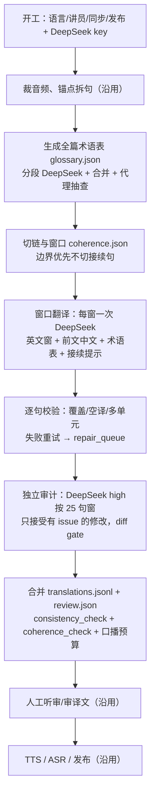

# 逐句优先 + DeepSeek 连贯翻译：流程重设计与验证实验

状态：**设计稿，2026-10-26。未实现、未运行。** 本页不改 [逐句优先 runbook](../../experiments/sentence-first-agent/AGENTS.md)、[路线文档](../sentence-first-agent-production.zh.md)、发布门禁或任何冻结 run；它提出一条新的 Layer 2 做法，并给出验证它的实验。所有结论来自 [#1397](https://github.com/JonathanJing/sermon-video-zh-subtitles/pull/1397) 的 benchmark 和 [#1399](https://github.com/JonathanJing/sermon-video-zh-subtitles/pull/1399) 的本地复跑／生产路径尝试，不是已采用的生产能力。

## 1. 为什么重设计

逐句优先路线把翻译定义成“句到句的函数”：每句只看前 3 后 2 句英文，独立翻译。这个假设让并行子代理很简单，但 #1397 的人工评估和 benchmark 显示，它也是残句、称谓漂移和重复要点译法不一致的主要来源：

- 每 12 句带前面已译中文的窗口（s2）在两个 Claude 评委下都是可懂度最高（7.50 / 8.89），已知问题修复 15/18、18/18；逐句 baseline 只有 7.00 / 8.28 和 7/18、10/18。
- 本地 DeepSeek 复跑（#1399）方向一致：s2 可懂度 9.11、已知 14/18；逐句 baseline 8.17、6/18；阅读版残句最少但不是配音形态。
- 把 1+2+3 接进正式 Layer 2 的 p123 只拿到 s2 约 60% 的可懂度收益（8.72 对 9.11），说明“每句最后仍单独定稿”会丢掉一部分跨句收益。

逐句优先路线**没有**正式 controller 的逐组独立约束，也不需要把接续句合并成组（合并会破坏 TTS 和字幕的固定句界），所以它可以采用比 p123 更直接的做法：**以窗口为翻译单位、以句子为产物单位**。这是本设计的核心改动。

## 2. 设计原则

1. **人审仍是唯一放行依据。** DeepSeek 译文、术语表、审计修改全部是机器产物；`humanApproval=false`，只有用户听完整轨、审过译文才发布。
2. **窗口是翻译单位，句子仍是产物单位。** TTS、字幕、`sourceUnitIds`、口播预算继续按句；窗口只决定“一起看多少句、带多少前文”。
3. **不合并句子。** 接续关系用提示（`continuesPrevious` / `continuedByNext`），不改句界；否则字幕、TTS 和英文对照都会错位。
4. **确定性、可恢复、可审计。** 翻译不再由子代理自由发挥，而由 DeepSeek runner 按请求哈希缓存；每句记录窗口、术语表哈希、模型/effort、提示版本、审计结论和成本。
5. **失败关闭，修复有界。** 覆盖不全、空译文、多出单元都在付费后立刻校验；单句重试有上限，超过阈值停跑并进入 `repair_queue.jsonl`，不生成半成品。
6. **不依赖正式 controller。** 这条路线继续只用 `artifacts/sentence-first-agent/<run>/`、现有 JSONL 和发布驱动；不要求 canonical Layer 1 包、controller 预算或语言插件。
7. **术语表是输入，不是提示词装饰。** 生成后写 `glossary.json`，算哈希，进每一条请求和 `run.md`；代理抽查人名、关系、神称代词，用户可在听审前改。

## 3. 新流程



### S0 开工与预检

沿用 AGENTS.md 第 0.5/0 步，另加：

- `DEEPSEEK_API_KEY` 只从 `~/.config/tongxing/deepseek.env` 注入，不进 `run.md`、不进 Git。
- 记录 `model=deepseek-flash`、翻译 effort `low`、审计 effort `high`、提示版本、术语表/句表哈希和本次成本上限。
- 目标语言、讲员、是否同步、是否发布仍先问用户；本流程不改变这些决定。

### S1 句子与锚点（沿用）

`prepare_clip.py` / `sentences.jsonl` 不变。每句保留 `id`、`english`、`start`、`end`、`pauseAfter`、`sourceUnitId`。窗口翻译的输出必须回到这些 `id`，不新增、不合并、不删除。

### S2 全篇术语表

- 输入：全部 `sentences.jsonl` 的 `id: english`，以及 `docs/series-terminology.zh.md` 的本系列条目。
- 按约 4,000 字符切片，每片一次 DeepSeek `low` 调用，带已知术语表；只返回新条目。合并规则：同一 source 第一次出现为准；`pronouns` 不覆盖已有值。
- 总量上限 6,000 字符，超出时按“文化梗 → 经文出处 → 重复要点 → 关系 → 人名”的顺序丢弃，并记录丢弃数。
- 输出 `glossary.json`：`people`、`relations`、`recurringPhrases`、`culturalReferences`、`scripture`、`pronouns`、`schemaVersion`。
- 代理抽查人名/关系/神称代词；用户听审前可改。改动后重算哈希，已缓存的窗口按新哈希失效。
- 产物：`glossary.json`、`coherence.json` 里的 `glossarySha256`。

### S3 切链与窗口

- 用 `continuation` 判定（与正式 `text/coherence.py` 相同的规则：上一句是否以连接词/逗号结尾、下一句是否小写开头等）给每句标 `continuesPrevious` / `continuedByNext`。
- 按原文顺序切 `chains=4`（可配 1–8）条连续链；**链边界优先放在 `continuesPrevious=false` 的句前**，不要等分。若找不到干净边界，退到最近的句号/场景边界，并在 `coherence.json` 记 `boundaryFallback=true`。
- 每条链内按 `window=12`（可配 8–16）切窗；窗口是请求单位，不是产物单位。
- 产物：`coherence.json`（options、链与窗口、边界原因、句表哈希、术语表哈希、模型/effort、提示版本）。

### S4 窗口翻译

每个窗口一次 DeepSeek `low` 调用，输入：

- 本窗全部英文句子（`id` + `english`），只翻译本窗；
- 前 8 句已定稿中文（`priorTarget`，链内顺序；链首为空）；
- `glossary.json`；
- 每句的 `continuation` 提示；
- 本窗后 2 句英文，仅用于消歧，不翻译。

要求输出严格 JSON：

```json
{"schemaVersion": "sentence-first-window-v1",
 "sentences": [{"id": "s0001", "target": "……", "coverage": [{"sourceUnitId": "asr-u0001", "targetText": "……"}], "issues": []}]}
```

- 必须逐句返回，顺序与输入一致，`id` 不得增删；`target` 非空；`coverage` 的 `sourceUnitId` 必须恰好等于本句单元。
- 译文要自然口语、保留人名/数字/否定/经文；接续提示为真时，本句要读成上一句的结尾或下一句的开头，不能写成悬空残句。
- 缓存键：`(backend, model, effort, system, user)` 的 sha256；同一窗口重跑不重复付费。
- 产物：`translate/window-0001.json`（请求、原始回复、解析结果、usage、cost）。

### S5 逐句校验与修复

窗口返回后立即逐句校验：

1. `id` 集合等于本窗输入；
2. `target` 非空、不是英文原文；
3. `coverage` 覆盖恰好一个 `sourceUnitId`，`targetText` 是 `target` 的子串；
4. 不含未翻译的整句英文（长度比例和 ASCII 词比例双阈值）；
5. 口播预算（同步模式）不超过 `budgetSeconds` 的 1.05 倍。

失败处理：

- 同一窗口重试 1 次，请求里带失败码和失败句（只重试失败句也可以，但窗口级重试更简单）。
- 仍失败：写 `repair_queue.jsonl`（句 id、失败码、原始回复哈希），继续下一个窗口；整篇结束后按句单独重译（每次带前后文、术语表、前文中文），最多 2 次。
- 任何句子最终没有通过校验：整篇停跑，不生成 `translations.jsonl`；报告具体句子和失败码。不能把 fallback 文本写进产物。

### S6 独立审计与 diff gate

- 每 25 句一个窗口，DeepSeek `high` 独立调用；只看英文、当前中文、术语表和前文中文，不看翻译请求的推理。
- 审计只返回问题，不自由改写：
  ```json
  {"issues": [{"id": "s0012", "code": "pronoun|name|number|scripture|omission|addition|continuation|register", "note": "……", "suggestion": "……"}]}
  ```
- 对每个 issue，runner 生成一个最小修改建议；**diff gate** 决定是否接受：
  - 只接受对应 issue code 的修改；
  - 不得删除 `priorTarget` 的连接词/话语标记，除非 issue code 是 `continuation`；
  - 不得改变 `sourceUnitId` 覆盖、数字、人名或否定；
  - 纯风格改写（无 issue）拒绝。
- 接受/拒绝都写入 `review.json` 的 `revisions` / `rejectedRevisions`，并保留机器原文；人工审核表显示两者。
- 这一步替代正式的“连读审核”（#1397 的五项里唯一没有可测收益的一项），但保留路线原有的“独立第二遍复核”，只是把它变成有 issue 证据的最小修改。

### S7 合并与检查

- 输出与 `translate_parts.py merge` 兼容的 `translations.jsonl`：每行 `id, locale, target, reviewNote`；`reviewNote` 为 `pass` 或 `revised: <code>`。
- `review.json`：`revisions`、`rejectedRevisions`、`notes`、`spokenForms`。
- 跑现有的 `consistency_check.py`，再跑新增的 `coherence_check.py`：
  - 句界/接续：每句的 `continuesPrevious` 与译文开头/结尾是否一致；
  - 术语：人名、关系、神称代词是否与 `glossary.json` 一致；
  - 数字/经文：英文出现的数字、章节是否在中文出现；
  - 口播预算：同步模式下 `estimatedSeconds` 是否超 `budgetSeconds`；
  - 覆盖率：447/447，无缺句/多句/空译。
- 任何硬检查失败都不进第 5 步（口播规格），与现有路线一致。

### S8 人工、TTS、ASR、发布（沿用）

第 8–10 步不变。审核表额外显示：窗口 id、机器原文、审计修改、拒绝的修改、术语表条目。用户仍是唯一放行依据；不发布时只留在 `artifacts/`。

## 4. 五项改进如何落到这条路线

| #1397 的改进 | 本路线适配 | 不做/不同的原因 |
| --- | --- | --- |
| 1 全篇术语表 | S2 生成、哈希、逐请求带；代理/用户可抽查 | 不把术语表当提示词装饰；它是输入 |
| 2 带前文中文的窗口 | S4 以 12 句窗口翻译，链内顺序，带前 8 句最终中文 | 不在每句后再单独定稿；窗口直接产出逐句译文，避免 p123 的二次损失 |
| 3 合并接续小句 | S3 标接续、S4 用提示；**不合并句子** | 合并会破坏 TTS/字幕固定句界；改提示 |
| 2b 窗口草稿 + 逐句定稿 | 作为 S4 失败时的备选（窗口草稿 + 逐句 finalize） | 本路线没有逐组独立约束，优先用完整窗口；只有覆盖/口播控制不住时才用草稿+定稿 |
| 5 连读审核 | S6 独立审计 + diff gate | #1397 的 s5 无可测收益；保留独立复核，但不做自由改写 |
| 4 阅读版 | 不做 | 本路线交付配音/字幕；阅读版是另一种产品，另行设计 |

## 5. 请求与提示合同

- 翻译（S4）：`deepseek-flash` / `low`；系统提示 = 逐句优先的翻译要求 + 术语表规则 + `priorTarget` 规则 + 接续规则 + “只翻译本窗，逐句返回，coverage 精确”。
- 审计（S6）：`deepseek-flash` / `high`；系统提示 = 只看英文与当前中文，按 8 类 issue 报告，不给风格建议。
- 术语表（S2）：`deepseek-flash` / `low`；切片规则同上，只补新条目，最多 12 条/片。
- 所有请求：`response_format={"type":"json_object"}`；`max_tokens` 足够覆盖窗口（12 句约 2k tokens，留 8k）；输入总字符上限 14,000，留出 16,384 的余量；每次记录实际字符数，超限在付费前失败。
- 提示版本、模型、effort、术语表哈希、句表哈希写进 `coherence.json` 和每句记录；换版本开新的 `translations.jsonl`，不混用缓存。

## 6. 失败、恢复与成本

- 单窗口失败：重试 1 次；仍失败进 `repair_queue.jsonl`，不阻塞其他窗口。
- 整篇结束仍有失败：停跑，不生成 `translations.jsonl`；输出失败清单。
- 恢复：按请求哈希读缓存；已通过的窗口和句子不重复付费；`--resume` 只补缺失。
- 成本：每次调用记录 usage 和按 DeepSeek 峰价估算的美元；`cost.json` 汇总。本次 benchmark 447 句约 1–2 美元/arm；实验预算另见第 7 节。
- 并发：链之间并行（最多 `chains` 条），链内顺序；`chains=4` 时最多 4 个窗口同时跑。生产可按 `groupWorkers`/Spark 队列时间调 `chains`，但要在 `run.md` 记实际值。

## 7. 验证实验

### 7.1 问题与假设

- **H1（质量）**：与逐句 baseline 相比，新流程减少残句、称谓漂移和重复要点，盲评可懂度提高，忠实度不下降。
- **H2（人审负担）**：新流程把人工修改率（每 100 句的编辑次数/归一化编辑距离）降低 ≥30%，审听时间不增加。
- **H3（操作）**：447 句全部有精确覆盖；单窗口失败可修复；没有未处理的 coverage 失败；成本/墙钟在预算内。
- **H4（审计）**：diff gate 阻止“删连接词/改风格”的审计修改，审计带来的忠实度损失为零或更小。

### 7.2 实验分期

**Phase 1（机制，10/25 证道，150 句分层样本）**：按残句、已知问题、接续句、人名/数字密度分层抽 150 句，覆盖约 12 个窗口。arms：

| arm | 做法 |
| --- | --- |
| A baseline | 逐句 DeepSeek，前 3 后 2 英文，无术语表/前文；保留现有独立复核 |
| B | A + 术语表（S2） |
| C | B + 窗口翻译与前文中文（S3/S4），不做审计 gate |
| D | C + 接续提示（S3） |
| E | D + 独立审计 + diff gate（完整新流程） |

Phase 1 只判文本，不跑 TTS/ASR。

**Phase 2（确认，10/25 全量 447 句 + 留出证道）**：只跑 A 与 E；留出证道选一篇未参与设计的整期（例如下一周或 10/18 的 54475d42），在 Phase 1 结论冻结后才跑。全量 A/E 用同一批评委；留出集只做方向确认，不调参。

**Phase 3（可选，音频）**：对 A/E 各 100 句跑 Spark TTS + ASR，比较回转写相似度、口播预算超限和合并后时长；不做整期发布。

### 7.3 指标

| 类别 | 指标 | 采集 |
| --- | --- | --- |
| 主指标 | 盲评可懂度/自然度/忠实度（1–10，25 句窗） | DeepSeek high + 第二个模型族（Claude 可用时） |
| 主指标 | 人工修改率、审听时间 | A/E 各 20 个盲法窗口，同一审阅人、随机顺序、计时 |
| 次指标 | 残句/漂移/代词/文化梗/错译数 | 同一评委，按 6 类 |
| 次指标 | 已知问题修复数 | 人工评估的 18 条（10/25）与留出集自己的清单 |
| 次指标 | 覆盖完整率、空译、多单元 | 确定性检查 |
| 次指标 | 口播预算超限、ASR 相似度（Phase 3） | `build_speech`/`asr_check` |
| 操作 | 调用数、成本、墙钟、重试/修复率、最大请求字符 | `cost.json`、`coherence.json` |

### 7.4 评委与盲法

- 每个窗口隐藏 arm 名，随机顺序；同一窗口的英文一致。
- 评委至少两个：DeepSeek high（与翻译同族，只作机制信号）+ Claude Sonnet/Opus（可用时）或另一个非 DeepSeek 模型；报告评委间相关，不把单一家族当结论。
- 人工盲评 20 个窗口（A vs E），同一审阅人、随机顺序、限时；记录每窗口用时和修改。
- 分差 <0.3 视为噪声；用配对 bootstrap（按句/窗）给 95% CI，报告效应量，不只报均值。

### 7.5 判定规则

采用新流程（进入 AGENTS.md）需同时满足：

1. 10/25 全量 E vs A：残句减少 ≥50%，人工修改率降低 ≥30%，可懂度提高 ≥0.4 或至少不降，忠实度不低于 A−0.1；
2. 覆盖 100%，无未处理失败；重试/修复率 ≤5%；
3. 口播预算超限不高于 A；成本/墙钟在预算内；
4. 留出证道方向一致（不要求同样幅度）；
5. 人工盲评没有“更难读/更不自然”的集中反馈。

任一不满足：只保留为实验，不改生产 runbook；把失败写进报告。

### 7.6 样本量与成本

- Phase 1：150 句 × 5 arms × 2 个评委 ≈ 1,500 个窗口评分；DeepSeek 翻译约 0.3–0.5 美元/arm，总计 <$3；评委约 $1。
- Phase 2：447 句 × 2 arms + 留出 350–450 句 × 2 arms ≈ $4–6；人工审阅 2–4 小时。
- Phase 3（可选）：Spark 100 句 × 2 arms，约 20–30 分钟 GPU + 听审。
- 总计预算建议 ≤$10 + 人审时间；不发布、不产生正式候选。

### 7.7 风险

- **同族评委**：DeepSeek 评委评 DeepSeek 译文会有偏好；用第二个模型族 + 人工盲评抵消，不能只报 DeepSeek 分数。
- **单篇过拟合**：10/25 参与设计，必须留出第二篇；留出集不调参。
- **人审疲劳**：20 个窗口限时、随机、同一人；记录用时；不要求一次审完所有 arm。
- **文本实验不代表音频**：Phase 3 只抽查，不声称整期音频验收。
- **句界风险**：窗口翻译可能让句子变长；用口播预算和 `build_speech` 检查，必要时回退到窗口草稿 + 逐句定稿。

## 8. 实施顺序与代码接口

1. **P0（1–2 天）**：`deepseek_translate.py` + `coherence_check.py` + prompts；20 句 pilot；单元测试（无付费调用）。
2. **P1（2–3 天）**：Phase 1 的 5 个 arm；judge 脚本；人工盲评表。
3. **P2（1–2 天）**：Phase 2 全量与留出；报告；决定是否改 AGENTS.md。
4. **P3（可选）**：100 句 TTS/ASR 抽查。

接口（都在 `experiments/sentence-first-agent/`，产物在 ignored `artifacts/sentence-first-agent/<run>/coherence-<arm>/`）：

命令里的 `$EXP`/`$RUN` 与 [AGENTS.md](../../experiments/sentence-first-agent/AGENTS.md) 相同。

```bash
# 术语表 + 窗口翻译 + 校验（arm A/B/C/D/E）
python3 $EXP/deepseek_translate.py --run $RUN --locale zh-Hans --arm E \
  --chains 4 --window 12 --prior 8 --glossary --hints --out $RUN/coherence-E

# 独立审计 + diff gate（E 的一部分）
python3 $EXP/audit_deepseek.py --run $RUN --input $RUN/coherence-E/translations.jsonl \
  --glossary $RUN/coherence-E/glossary.json --window 25 --diff-gate

# 检查与合并
python3 $EXP/coherence_check.py --run $RUN --arm-dir $RUN/coherence-E
# 新流程直接写 translations.jsonl（schema 同现有）；translate_parts.py merge 只用于 baseline arm

# 实验驱动与评委
python3 $EXP/run_coherence_ab.py --phase 1 --run $RUN --sample 150
python3 $EXP/run_coherence_ab.py --phase 2 --run $RUN --held-out <second-run>
```

- `deepseek_translate.py` 只写 `translations.jsonl`/`review.json`/`coherence.json`/`cost.json`，不改 `speech.jsonl`、`tts/` 或发布文件。
- `audit_deepseek.py` 只写 revisions/rejected，不改原文；人工审核表同时显示。
- 所有脚本 `--help` 可看参数；默认不调用付费 API，显式 `--execute` 才发请求。
- 测试：链边界、覆盖校验、空译/多单元、diff gate、术语表合并、预算上限、缓存命中；用 10/25 的前 20 句做离线夹具，不付费。

## 9. 采用后要改的文档与门禁

如果 Phase 2 通过：

- `experiments/sentence-first-agent/AGENTS.md` 第 4 步改为 S2–S7，保留第 5–10 步；`run.md` 增加术语表/模型/窗口/成本字段。
- `docs/sentence-first-agent-production.zh.md` 的“不调用外部翻译 API”改为“翻译走 DeepSeek，审计/人审不变”；成本表加 DeepSeek。
- `preflight.py` 增加 DeepSeek key 和模型/提示版本的检查。
- 不改人审、听审、发布门禁；不放宽 `human_reviewed` 的条件。

## 10. 限制

- 本页是设计稿，没有实现、没有跑过新流程；所有质量数字来自 #1397/#1399 的 benchmark，不是本设计的实测。
- 逐句优先路线没有正式 controller 的哈希绑定；本设计增加请求/术语表/句表哈希，但不把整条路线升级成 canonical 生产。
- 实验是文本为主；TTS/ASR 只做 Phase 3 抽查，不能替代整期音频验收。
- 留出证道的选择要在 Phase 1 结论冻结前确定，避免“看过结果再挑样本”。
