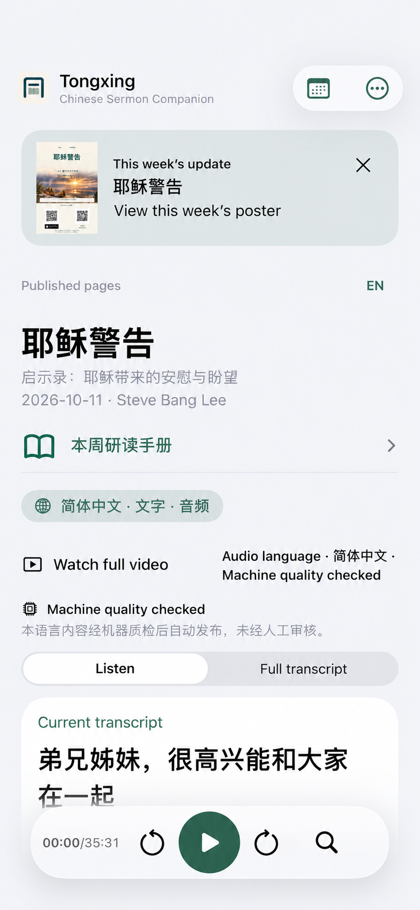
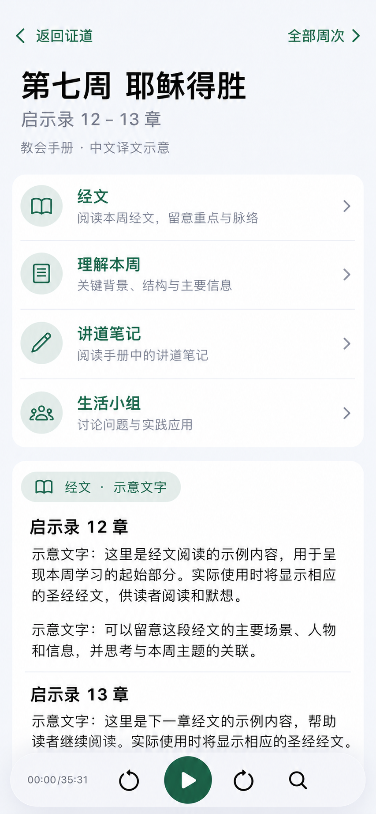

# 同行 App 每周系列手册设计

状态：设计与合成界面预览，待评审；正式手册接入未实现、未发布。基线：`dev@3414918205e7cc666362f93799bdd4bfdfa28429`。首个目标：Mariners Church《启示录：耶稣带来的安慰与盼望》系列。用户已确认：**手册每一周对应一篇讲道**。

本 PR 增加合成 SwiftUI 界面：Debug 显式 UI 测试以及本轮 BetaRelease 的「手册界面预览 · 测试样本」入口可使用；不包含真实手册、正式周次映射或内容分发。正式 Release 不含预览；正式入口和旧学习资源展示仍须随版本化发布／验收合同迁移。播放栏的最小化功能已在代码中移除；实际验证结果以 PR 中的检查记录为准。

## 目标与现状

听众打开一篇证道时，能顺手阅读与它对应的那一周手册：经文、讲道笔记、图表和生活小组讨论；也能从系列目录查看前后各周。产品以教会发布的材料为主要研读内容，建议移除 App 中独立的「大纲与默想」展示，将「本周研读手册」作为研读入口。手册保持独立来源和审核状态，证道播放与字幕继续可用。

现有 iOS [大纲入口](../../apps/tongxing-ios/App/ContentView.swift)与已审核的 outline／meditation 属于证道学习产物。[四产物公开合同](../layer4-four-product-public-delivery.zh.md)绑定讲道来源、候选及审核，release v3/v4 恰好声明七种资源。手册来自另一份书，不能装成该 outline、继承它的人审状态，或未经合同变更直接向 release 增加第八个资源。本设计提出独立、可选的手册资源；具体 schema、实现和兼容测试由后续实施 PR 完成。

目前本机 `artifacts/reference/revelation-series-guide/` 有逐页中英材料、中文 PDF 和排版工程，均为忽略的本地参考资料。中文是机器翻译，未人工审校；原英文自动抽取的表格和分栏可能乱序。逐页中文稿中的整页 CSB 经文仅记章节范围，中文排版 PDF 使用 1919 和合本。手册及部分插图版权属于原权利人，本地材料注明仅供个人研读、不作发布或分发。引用本文件不代表拥有公开分发权或已通过审核。

### 内容取舍与迁移

- **以教会材料为主**：手册里的讲道笔记、背景、讨论和不同观点，按来源及原有结构呈现，不再单独展示项目生成的大纲或默想。标明「教会原手册」与「中文翻译」各自的来源；项目制作的译文即使译自教会资料，也不能冒称教会官方译本，机器翻译及其审核状态如实披露。证道翻译和字幕仍按原有审核状态展示，不因使用手册而升级。
- **统一移除旧展示**：后续 iOS 实施时，一并处理 legacy 与多语言证道页的「大纲与默想」按钮和 sheet、全文内嵌的大纲／默想，以及音频不可用时“先阅读证道大纲”的提示。无手册的历史讲道继续保留收听、字幕和全文，不用自动生成的大纲补位；有授权且适合的原始资料链接可单独提供。网页端是否及何时同步需要在实施阶段明确，不能把本设计视作网页已变更。
- **保留历史发布兼容**：隐藏展示不等于删除已经发布的资源或改变历史 release。当前 v3/v4 合同要求七种资源及其校验，并要求端点上报 `studyDisplayed=true`、验收 `outline` 和 `meditation` 展示。移除展示的客户端不能继续声称满足这些旧展示验收；需先设计并评审版本化的客户端能力／验收合同和迁移，真实记录旧端与新端各自状态，保留旧客户端、历史目录及资源读取兼容。手册的显示和审核应有自己的验收，不伪装成原四产物的大纲或默想。是否停止未来生产大纲、默想属于后续独立的生产合同变更，不能由本设计直接推断或执行。
- **处理当前读取耦合**：现有 `AppModel.loadSelectedPublishedTranscript()` 在同一流程依次读取 release、全文及学习资源，学习资源失败会使全文显示读取失败。实施时须设计证道与不再展示的学习资源的失败边界，保留适用的 release 身份和完整性校验，并以版本化合同明确缺失资源时可作出的声明；不可通过简单吞掉错误或删按钮来宣称旧合同通过。分别测试旧 v3/v4、资源缺失和离线场景。

## 阅读体验

### 从证道进入

在首页当前讲道标题下、语言控制附近的原研读入口位置显示一行「本周研读手册」：左侧用同行绿的系统书本图标（候选 SF Symbols `book`），右侧为前进指示；图标与文字组成同一个完整点击区域，VoiceOver 读出「本周研读手册」，不能只靠图标辨义。只有目录有明确关联时才展示入口；没有关联时不额外占据证道页面，也不猜测周次。点入以系统导航和阅读页呈现，返回后仍是原证道和原播放状态；阅读不会启动、暂停或重置播放器。若手册正在加载，显示加载状态；下载失败提供重试及可用的已验证离线版本提示，退出阅读不影响证道。

首页图是 AI 生成的布局示意，不是运行截图；其示例讲道与下方第 7 周阅读页是各自的示意状态，不代表已核对的周次映射。手册入口行的向右箭头表示进入手册，不是播放栏缩小按钮。

阅读页按内容本身组织，缺少的区块不显示：

1. **本周经文**：章节范围与已获许可的经文正文；仅有经文引用时显示引用，不暗示正文已提供。注明译本和来源。
2. **理解本周**：手册提供的背景、故事梳理、图解与表格。窄屏表格可转为逐项卡片，保留行列关系、标题和经文引用；有说明文字的图片需提供可访问替代文字。
3. **讲道笔记**：呈现手册原有提示与结构，保留可以填写的空白含义；不把手册笔记称作对实际录音的逐字摘要。
4. **生活小组讨论**：保留原有「靠近／向下看／向外看／向内看」等分组与问题顺序，让组员能逐项阅读。
5. **延伸阅读**：存在对应附录时，按原手册并列展示不同观点和归属，不改成 App 的单一结论。

页顶标明手册标题、系列周次、经文和对应讲道；页尾提供来源、翻译与审核状态。书中“见第 N 页”改为可用的章节内链接，并保留明确标识版本的原页码供核对；英文原书页码与中文重排页码不可混用。页面支持系统字号、VoiceOver 阅读顺序、深色模式、小屏及横屏；正文避免截断，关闭按钮与播放器不遮挡末尾内容。具体排版遵循 [iOS 设计约定](../../apps/tongxing-ios/DESIGN.zh.md)。

例如第 7 周「耶稣得胜」对应启示录 12–13 章：英文手册 PDF 页序 97–107 中，98–99 是故事与象征表，104–105 是讲道笔记，106 是小组讨论；相应附录可独立展开。这只是待核对的结构样例，不是批准发布的文字或实际录音身份证明。

### 界面与交互细化

用户选择第 2 个目录式方案，并要求实际浮窗适配 iOS 27.1。以下图片是按选择调整的 **AI 生成概念图**，用于讨论信息层级和浮层方向，正文与问题是示意文字，不是教会原文，也不是 iOS 截图。视觉和交互须以真实 SwiftUI 和截图核对。

- **证道页**：在讲题和语言控制附近用书本图标加「本周研读手册」，次行显示「第 7 周 · 启示录 12–13 章」。原播放器与字幕区域保持位置和行为。只在存在经核对映射时显示；映射已知但该语言未提供时，进入后说明语言不可用，不悄悄换语言。
- **手册首屏**：全高系统导航，顶部「返回证道」和「全部周次」；正文显示系列名、第 7 周、标题「耶稣得胜」与经文范围。标题下就近显示来源「Mariners Church 系列手册」和译文实际状态，点击可查看原文来源、翻译者／方式、审核状态及版权说明。译文状态不与证道的审核标签合并。
- **章节导航**：首屏使用单组目录列表，依次列出「经文、理解本周、讲道笔记、生活小组、延伸阅读」，各行包括图标、标题、简短说明和进入提示；缺少的章节不显示。点选跳到同一阅读页的正文对应标题并将无障碍焦点移至标题；正文默认连续可读，不把每一段都藏在折叠卡片中。手册没有可用经文正文时显示经文范围和说明，不能做无法打开的按钮。
- **长文与图表**：使用系统语义背景、正文、标题与分隔线；同行绿强调操作，避免长文放进多层卡片。手机上将象征表按原行展开为「形象／手册中的解释／经文出处」，不改变原有对应关系；iPad 保持受限宽度单列阅读，不假设已有双栏。可用且有许可的图应可放大并有文字替代。
- **小组讨论**：保留手册中的「祷告」节奏提醒和「靠近、向下看、向外看、向内看」次序，问题正文直接可读；长问题自然换行。第一版的留白不伪装成可编辑输入框。
- **播放与返回**：阅读时使用现有唯一播放器及其安全区，不新增独立播放器；打开、跳章节、浏览其他手册周次或返回不改变播放意图、音轨或进度。只有明确选择「打开对应讲道」才切换讲道；切换前后的具体播放意图需沿用并验证现有行为，不自动启动另一篇。
- **空态**：手册对应关系不存在时隐藏入口；映射已知但该语言缺失时显示「此语言的手册尚未提供」，可返回证道；网络失败显示重试，若有仍获当前清单认可的完整缓存则标明版本并可离线阅读；校验失败不得展示损坏内容。状态不得声称内容已下载或审核通过。
- **设备与可访问性**：正文随 Dynamic Type 增长，不固定行数、不缩字；所有操作至少 44 pt，支持 VoiceOver 的标题层级和阅读顺序、深色模式、横屏与大字号。导航和播放控件不能遮挡正文末尾；切换手册语言与界面语言的动作分开。

### iOS 27.1 浮层与适配

手册阅读使用系统大尺寸 sheet 或等效系统导航容器，保留系统圆角与自适应呈现；不把长正文铺在玻璃上。普通竖屏的播放控制使用现有 `PlaybackDock` 和唯一 `PlaybackController`，采用单层 `.regular` Liquid Glass，并通过已有 `listeningBottomBar` 在 iOS 26 及以上接入 `safeAreaBar` 与滚动边缘；正文末尾必须能滚到控件之上，不能只叠加悬浮图层。

按照用户决定，首页和手册页的播放栏不再提供最小化：移除右侧向下箭头和缩小／展开状态，同时移除对应拖动手势、上下文菜单及 VoiceOver 收起／展开操作与提示；保留播放／暂停、前后微调、时间及放大镜定位／更多操作。大字号或宽度不足时仍可使用自适应布局，但不能悄悄进入只有播放键的最小化状态。实际改动涉及共用 `PlaybackDock` 的其他页面及竖向系统栏，必须同步核对所有宿主与对应 UI 测试；本 PR 不改变现有 App 行为。

iOS 27.1 提供竖向系统工具栏时，手册容器也应按主收听页同样的环境条件适配系统侧栏，按实际安全区与激活的 `.division` 区域避让；不能按机型名称或固定坐标猜测。现有主页面已有相关适配，但当前阅读 sheet 并不会自动继承它，须在实现中处理并验证。播放「更多」面板复用现有按按钮实际位置、遮挡区域与空间计算的逻辑，空间不足时退回系统 sheet，不另造固定位置浮窗或叠加第二层玻璃。

iOS 17–25 沿用现有 `safeAreaInset` 和标准 Material 回退；减少透明度时使用实底，增强对比时保留明确边界。验收分别覆盖 iOS 27.1 普通竖屏、宽横屏及可用的 Duo 内外屏／半折、iPad、大字号、VoiceOver、深色与减少透明度。概念图不证明任何系统浮层或设备行为已经通过验证。

### 浏览全系列

在手册阅读页提供「全部周次」，列出系列标题、每周标题和经文；点选某周先进入该周手册，再提供明确的「打开对应讲道」操作。阅读第 7 周期间浏览第 6 周，不隐式切换或重置当前音轨。某周手册或讲道尚不可用时，显示各自的状态，不能把缺少的内容指向另一周。卷首、导论及非逐周附录放在系列资料里，不强塞进每周。

第一版不要求用户账户，不收集或上传个人回答；纸本空白处先以留白或提示呈现。可编辑个人笔记、同步、分享和导出是后续独立设计，需单独处理保存、删除、备份与隐私。

## 关联与内容模型

以下是实现方向，不是现有 schema，也不赋予发布资格。

- **系列与周次**：稳定 `seriesId`、`guideWeekId`、周序、手册周标题和经文范围。`guideWeekId` 在修订译文或重新分页时保持稳定；新增版本不覆盖旧版本身份。
- **讲道映射**：经核对的 `guideWeekId ↔ sermon family pageId` 一对一记录。单一来源时就是对应 page ID；catalog v5 的多个语言 edition 属于同一讲道 family，不是额外手册周次。v4/v3 回退时，通过受控映射将真实 edition ID 解析到同一 family；旧 catalog 缺少可证明的映射时不关联。校验同一系列中周次和讲道各最多出现一次，并检查映射目标存在；标题、经文是人工核对线索，不是自动匹配依据。
- **语言内容**：以系列、周次、locale 和内容版本确定一份手册。版本化清单记录可用语言、每份内容的 URL、字节 SHA-256、来源与审校状态；资源必须包含相同身份，下载后先核对再展示。无中文之外的有效内容时，各自显示「此语言的手册尚未提供」，不静默借用中文或继承中文审批。
- **内容区块**：使用有序、版本化的结构化区块，至少支持标题、段落、经文引用及经许可的正文、列表、表格、图文、讨论问题和内部引用。区块记录来源文档版本与源页；图表和经文保留独立的权利与来源信息。保留空白笔记页的用途，不能把空页当成漏译或自动生成内容。
- **证据与审核**：每个版本绑定英文原手册版本及 hash、来源 URL、源页范围、译稿 hash、locale、审校结果及可公开的披露；许可范围和审核收据的私有细节不进公开包。手册的授权与审校不继承证道、其他语言或其他版本。修订后需重新验证所改变的内容和相关收据。

清单和具体手册文件独立于既有七项证道资源与 release 身份；选择独立发布端点和版本化合同时，实施 PR 须定义完整 schema、来源与信任边界、兼容策略和安全 URL 规则。不能只给旧 release 添字段后宣称客户端可用。旧客户端继续消费旧目录；新客户端在无手册清单、未知版本、关联不完整或文件校验失败时安全降级，原有证道照常工作。

## 获取、离线与更新

手册资源按需读取；缓存键包含系列、周次、locale、版本和内容 hash。仅完整下载、身份一致且 hash 校验通过的资源可标为离线可用；下载中断、解码失败、未知 schema 或 hash 不符不得替换已验证缓存。若更新失败，可继续显示尚被当前清单认可的旧版并标明版本；如果新清单撤回该版本、许可或状态无法确认，则不展示撤回内容。无网络且没有合格缓存时，显示「尚未下载」和联网重试，不影响证道、音轨及其缓存。

手册的内容更新与讲道发布解耦：缺手册不阻断已有证道发布；手册资源自身仍必须符合确定的授权、审核与交付规则。不得通过更新手册改变已封存的讲道 release 或绕开它的身份校验。

## 内容准备与发布边界

1. **本地验证**：以第 7 周做受控预览，建立候选结构、来源页映射及明确讲道 ID；与英文书逐项核对图表、问题和引用，区分尚未审校的机器译文。源材料仍留在忽略目录，不把原书、原图、完整译稿或私人收据提交 Git。
2. **权利确认**：在对外分发前，分别确认原文／译文及节选、图表／插图、所用经文译本在目标渠道与语言下的使用许可；记录范围和限制。免费可访问、附来源或使用 AI 标注均不自动构成分发许可。
3. **逐语言审核**：核实译文与原文、神学术语、经文、分页交叉引用及图表；按实际状态披露。个人预览不等于人工审核或公开发布。其他语言须独立制作和审核。
4. **受控交付**：实现并评审版本化内容合同与客户端后，先验证 Dev 上实际资源及明确映射，再决定正式发行。清单、文件字节和实际客户端读取分别留证；线上 HTTP 成功不等同 iOS 真机、浏览器或小组现场验收。Web 是否同步支持在实现阶段明确为 required、deferred 或 not applicable，不能推定已支持。

## 实施顺序与验收

| 阶段 | 工作 | 退出证据 |
|---|---|---|
| 1. 第 7 周样页 | 核对对应讲道 ID、源页，做本地结构化样本和 SwiftUI 阅读体验；保留可追溯的模拟或受控内容 | 小屏、iPad、大字号和 VoiceOver 实际操作；返回后播放状态不变；样本不构成公开授权 |
| 2. 合同与读取 | 设计 schema/版本、映射校验、资源身份与缓存；实现可选清单及失败降级，并为取消旧展示设计版本化验收迁移 | 定向测试一对一冲突、v5 family 与旧 edition 回退、缺语言、错 hash、中断、撤回、旧客户端兼容及新旧展示验收诚实区分 |
| 3. 权利与内容 | 确认目标渠道许可，逐语言核对并按实际状态披露 | 与具体源和译文版本绑定的许可范围及审核证据；未获许可内容不进入公开包 |
| 4. Dev 端到端 | 发布授权范围内的 Dev 候选，验证真实读取、版本、对应关系及离线 | Dev HTTP/hash 回读、真实 App 页面与离线操作；独立记录浏览器或真机检查结果 |
| 5. 扩展与正式发行 | 核对 12 周逐一映射与每周资源状态，按项目现行流程单独发行 | 仅报告已完成的发行、设备及现场证据，不把一个结果提升为另一个 |

UI 实施遵循 [iOS 工作约定](../../apps/tongxing-ios/AGENTS.md)：记录基线、构建和实际操作，保留同条件前后截图并进行独立审核。合成界面不包含真实手册资源或发布授权；尚未完成的前后截图、人工确认、设备与现场检查均不得标记为通过。
