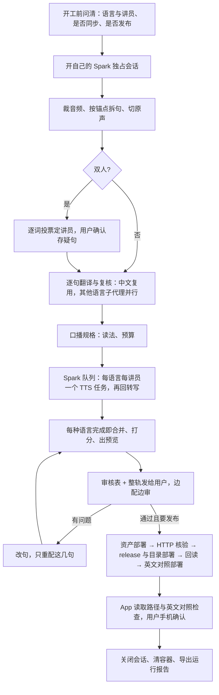

# 逐句优先、代理直做的配音生产路线

本页完整说明这条路线：它是什么、什么时候用、每一步由谁做、有哪些检查、要多久、花多少、还缺什么。可执行的命令和参数在 [runbook](../experiments/sentence-first-agent/AGENTS.md)，本页不重复命令。

## 一句话

英文按句拆开，Claude 代理逐句翻译、复核，Spark 用讲员自己的声音逐句合成，合并成整轨；用户听完整轨、审过译文后，以 `human_reviewed` 发布到同行正式页面。除发布那一步用仓库的受保护发布器以外，其余全部在代理会话里完成，不走正式流水线和它的哈希绑定、机器质检豁免。

交付类型是 `four_layer_release` 的 Layer 4 页面（每个 `pageId + targetLocale` 一个 release），不是 `live_session`，也不是 `dual_pdf`。

## 什么时候用，什么时候不用

| 用这条路线 | 用正式四层流水线 |
|---|---|
| 用户要求由代理直接做完，愿意亲自听审每条整轨 | 需要机器质检豁免、无人值守发布或可校准的质检 |
| 双人播客、对谈，或正式流水线还不支持的形态 | 单讲员周更，已有 controller、speech job 和指纹同步 |
| 配音可以作为独立音轨，不跟原视频同步，或愿意人工认可精简稿 | 必须跟原视频逐段同步、提供听音定位 |

两条路线可以共用 Layer 1：本路线只读正式生产的批准窗口、锚点清单、说话人区分与标签映射、已批准的译文，不写入正式生产的目录。同一期如果两条路线都做，只能有一个 `pageId` 发布，另一个要换 id 或替换。

## 和四层的对应

| 层 | 本路线怎么做 | 产物 |
|---|---|---|
| Layer 1 英文与锚点 | 沿用正式 Layer 1 的批准窗口与锚点清单；每个锚点单元就是一句；双人时按说话人区分结果逐词投票给每句定讲员，一致度低的句子请用户确认 | `sentences.jsonl`、原声切片、`speakers.json` |
| Layer 2 译文 | 已有批准的中文就直接按句用；其他语言由子代理并行逐句翻译并自我复核，主代理合并、补读法 | `translations.jsonl`、`review.json` |
| Layer 3 音频 | Spark 上的 Qwen3-TTS 讲员 checkpoint 逐句合成（单讲员 batch 8、8 个模型副本，2026-10-24 实测 4.3–5.9 倍实时；对谈仍可 batch 1；不拉伸、不变速），Qwen3-ASR 回转写打分，本机按英文起点合并 | `tts/`、`asr.jsonl`、`track.wav`、`schedule.json` |
| 审核 | 用户听每条整轨，审非中文译文，结论写成审核收据 | 审核表（CSV）、`human-review-verdict.json` |
| Layer 4 发布 | 发布驱动生成页面、文稿、字幕、MP3 与 release v2；先部署资产、HTTP 核验，再部署 release 与 v5/v4/v3 目录、回读；最后部署英文对照 `/english-reference/<pageId>.json` | 线上 Hosting 版本 |

Layer 1 变了，所有语言都要重做；某一种语言的译文或配音变了，只重做这种语言。改一句只重配这一句。

## 流程

## 谁做什么

| 角色 | 做什么 |
|---|---|
| 主代理（本会话） | 开工确认、拆句、讲员分配、中文对齐、合并与读法、口播规格、Spark 编排、收尾、审核表、发布、报告 |
| 翻译子代理 | 每个只拿一份句表（含前后文、讲员、参考译文），逐句翻译并第二遍复核 |
| Spark | 在本路线自己的独占会话里，以登记任务的方式跑 TTS 与回转写；一次一个任务 |
| 用户 | 开工前的三个决定、存疑讲员句的确认、整轨听审与译文审核、每次正式部署的授权、手机上的最终确认 |

## 检查

| 检查 | 在哪一步 | 拦住什么 |
|---|---|---|
| 合并检查 | 并行翻译合并 | 缺句、多句、乱序、空译文、语言不对 |
| 口播检查 | 口播规格 | 读法没对上任何句子、口播里还有阿拉伯数字、粗估超预算 |
| 回转写相似度 | 每种语言收尾 | 漏读、读错、错句；同音字差异不算 |
| 人工审核 | 审核表 | 译文与配音的一切问题；这是唯一的放行依据 |
| iOS 文稿规则 | 生成发布文件 | 句子时间越过 `durationSeconds`、乱序、重复、缺 `sourceUnitIds` |
| 英文对照覆盖 | 生成英文对照 | 英文来源未经人工批准、某个锚点单元缺失或重复、release 或文稿哈希对不上 |
| release 固定路径 | 生成与暂存 release | 页面、文稿、字幕不在 `/pages/`、`/content/`、`/captions/` 下以 pageId 和语言命名的固定路径上（正式版 App 会隐藏整页） |
| HTTP 核验与回读 | 两次部署之间与之后 | 线上文件与本地 SHA 不一致、MP3 不支持 Range |
| 目录投影检查 | 线上快照 | v4/v3 与 v5 投影不一致；只有页面默认语言的差异可以修正 |

没有的检查：没有机器质检校准，不能用豁免代替人审；没有声音指纹同步；实验目录里的中间产物不做哈希绑定（发布包本身仍绑定来源、候选、音频与审核收据的哈希）。

## 时间与花费

以 2026-10-22 一期双人播客（40 分钟原片、746 句、中韩西三语）为参考，不是承诺：

| 环节 | 用时 |
|---|---|
| 裁音频、拆句、讲员分配 | 几分钟 |
| 子代理并行翻译（每语 4 份） | 每份 2–4 分钟，并行 |
| Spark 配音 | batch 1 每种语言约 36 分钟（约 1.35 倍实时）；batch 8 × 8 副本时 31 分钟证道每种语言 6–7 分钟（4.3–5.9 倍实时）；语言之间排队 |
| 回转写 | 每种语言约 2 分钟 |
| 用户听审 | 约等于整轨时长（原片的 1.25–1.3 倍）乘语言数 |
| 发布（两次部署、核验、回读） | 约 45 分钟，含等待授权 |

50 分钟单人参考（原始断句、batch 8、三语）：19:00 开工 → 19:10 英文表 → 19:25 TTS → 19:50/20:17/20:44 可审 → 21:15 页面。每条可审前，`finish_run.py` 在同一次收尾里完成音频对齐（ASR 回转写、合并/排程、96 kbps review MP3、逐句播放器）；音频对齐不是发布前的单独一步。海报由独立 agent 制作/上传，iOS 推送由 App 侧触发，都在页面发布后随推送进行，不占主生产线关键路径。

31 分钟单人参考（2026-10-24 官方录音重建，447 句，batch 8 × 8 副本）：裁切到英文对照上线 48 分钟（20:14 → 21:02），其中 Spark 三语 TTS 加回转写 22 分钟。这一版把人工听审放到了上线之后，不是可复制的顺序；正确顺序见 runbook 第 8、10 步。

花费：不调用付费模型 API。翻译子代理每份约 8–12 万 token，走 Claude 订阅额度；Spark 是本地 GPU；Firebase Hosting 每次部署不另计模型费用。主要成本是用户的听审时间。

## 需要用户决定或授权的事

- 目标语言、讲员，以及缺授权或缺语言能力的讲员怎么办。
- 是否跟视频同步；同步就要精简口播稿，并认可精简稿。
- 是否发布，页面标题、类别小标题、讲员栏。
- 一致度低的讲员句。
- 审核结论。
- 每一次正式部署；目录投影修正这类会改动其他页面字段的步骤要单独说明。
- 关闭或收尾别人的 Spark 会话、改合成批量等偏离默认的做法。

## 已知限制

- 对谈几乎没有停顿，自然语速的配音比原片长约四分之一，只能作为独立音轨；要同步就要精简。
- Spark 独占会话一次只接纳一个运行中的任务，三种语言只能排队；8×8 批量合成已在 2026-10-24 两轮单讲员生产中使用，双讲员仍只有 `tts_pool.py` 的 4+4 路径。
- 发布改由单一驱动 `sfa_publish.py` + 页面配置 `pages/<pageId>.json` 完成（2026-10-31，`DEV-SF-004`）：配置字段见 `pages/page-config.schema.json`，未知字段会被拒。旧版按页复制的驱动保留给未迁移页面和特殊修复路径（撤回、alignment sidecar、fix-content）。
- 收据与发布包的绑定靠本地文件：发布过的 `human-review-verdict.json` 一旦改写就断链（2026-10-24 重建版），收据只追加版本（`DEV-SF-002`）。
- 公告 sidecar、海报收据、统计目录各自绑定 release 或音频哈希，撤回重建后不会自动跟随（`DEV-SF-005`）。
- 开发版 App 不做 release 路径检查；正式版能否看到，要用 App 的 Swift 校验或正式版实机确认。
- 英文对照绑定每种语言 release、文稿、字幕的哈希；它们任何一个变了都要重新生成英文对照，否则 App 不显示英文。
- 没有生成摘要、大纲。
- 浏览器播放、离线下载、现场使用没有单独验证；手机确认靠用户。

## 相关文档

- [Runbook](../experiments/sentence-first-agent/AGENTS.md)：每一步的命令与参数。
- [逐句优先设计](design/sentence-first-dubbing-path.zh.md)：从第一性原理推导的路径，以及将来接回正式流水线的样子。
- [双人播客制作规范](podcast-dual-speaker-production.zh.md)：正式四层下的双人播客。
- 运行记录：[7 分钟片段首跑](reports/20261021-sentence-first-agent-first-clip.zh.md)、[播客整期](reports/20261022-sentence-first-podcast-full-episode.zh.md)、[正式发布与 iOS 修复](reports/20261022-podcast-production-publication.zh.md)、[从设计到发布的复盘](reports/20261022-sentence-first-production-retrospective.zh.md)。
