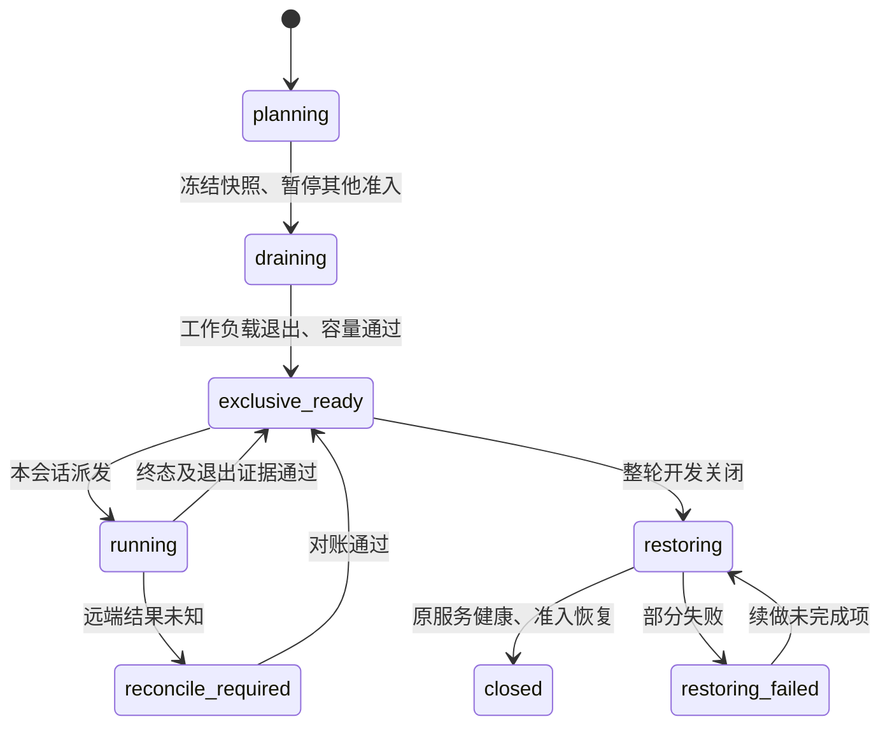

# Spark 整轮开发独占会话设计

状态：已实现，控制层通过离线与实机无推理验证；证据见[验收报告](reports/20261005-spark-exclusive-control-verification.zh.md)。用于页面实际制作及真实模型测试，独占窗口跨越多次测试和返修，整轮开发结束时才恢复原服务。纯离线单元测试不需要占用 Spark。

2026-10-05 用户修正：页面制作拥有高优先级，不等待其他任务自然空闲。先保存其他任务状态，再暂停入口并中断竞争工作负载；不支持检查点的任务允许保存参数和产物后中断，结束后从已有产物重跑。未知 API 调用先对账，不自动重发。此处“恢复”包括服务重启和从已有产物重新执行，不能宣称任意 GPU 进程都能恢复到同一条指令。

2026-10-13 用户决定：**只调 API 的环节不占 Spark 会话**。Layer 2 翻译与复核、文本质检（回译评判）、Codex Supervisor、学习笔记、英文机器审核、阅读版本、旧页面文本与源音频转写都只调远程 API 或 Mac 本地 Codex CLI，不再检查独占会话，也不再为每次调用建立 Spark job hold（`SessionBoundCaller(..., requires_spark=False)`）。这些环节进行时 Spark 上的服务照常运行；进程异常退出也不会让会话进入 `reconcile_required`。GPU 环节不变：TTS 渲染、配音初筛 ASR、音频质检、MFA 和本地模型调用仍要求会话及 job hold。周更只在 Spark 环节期间 begin 会话，结束后 finish。

### 合并后的首次运行与缓存身份

PR #380 将 API 质检评判的 `sessionCheck` 改为 `none_api_only`，属于新的评判身份。合并后的第一次运行必须冻结最终 commit 和质检实现哈希，使用新的 QC state、评判缓存及响应目录，不复用旧缓存，也不通过 `reuseBudgetRoots` 引入旧评判身份的回复；旧目录保留作证据。按最终代码重新校准、质检和生成放行证明后，后续同一冻结身份才可按 #381 的已批准来源复用合同恢复。API 不占 Spark 不等于未知结果可以重发：独立 API/CLI outcome 收据或原有预算账本仍须先对账。

## 当前发现

核验主机 `achillesjing@192.168.1.152`：Docker 所有容器均已停止，但 GPU 上仍有 `llama-server.service` 的 llama-server 进程，报告 35,695 MiB（约 34.9 GiB）。主机 MemAvailable 为 76,301,090,816 bytes（约 71.1 GiB）。这些是调查时刻的读数，不是未来开跑保证。

`llama-server.service` 与 `llama-performance-collector.service` 的 Restart 为 always；`spark-agent.service` 和 `spark-api.service` 为 on-failure。只处理 Docker 不能释放这部分内存；应经服务管理入口停止模型，并阻止调度器重新派发。

Spark Agent 工作目录为 `/home/achillesjing/spark-agent-current`，存在 `resource_control` 的 admission、lease、ownership 和 cleanup 代码；`scheduler_entry.py` 标注 offline deployment。当前检查未证明 guardian 和 hooks 已生效，后续核对实际入口再决定复用。本仓库音频 wrapper 的锁仅保护指定 broker 下的音频 job，不能阻止其他仓库、常驻服务或直接启动的进程。

## 最小实现

在 Spark 上设主机级固定路径的账本和 owner 锁，例如 `/home/achillesjing/.local/state/tongxing-spark-exclusive`。同一 developmentSessionId 绑定多次 runId，不按 run 各建独占目录。begin 在事务锁内持久化 active session；后续命令逐次核验 sessionId、owner 和 revision，不依赖 SSH 连接持续打开。运行级 GPU 锁仍保留。

已实现 [scripts/spark_exclusive_session.py](../packages/production/src/tongxing_production/compute/spark_exclusive_session.py) 的 inspect、begin、status、require、job-start／bind／end、finish、reconcile 和 resume-begin。主机状态固定存储，SSH 传输按代码 hash 部署 stdlib 模块，无推理或运行时安装。控制目标为当前四个受管 unit，以及抢占开始时冻结的全部运行容器；不可恢复的 AutoRemove 容器会在停止前拒绝。

| 阶段 | 行为及验收 |
|---|---|
| 暂停准入 | 优先接入已实际部署的 guardian；否则暂停 Spark API 和 scheduler 的受管入口，通过 SSH 保留状态检查。维护状态未证明生效不能报告 ready。直接 SSH、其他调度器逐项标明是否受管，首版不宣称能防止管理员绕过 |
| 保存恢复快照 | 记录原先运行的目标服务／容器、完整 container ID、image ID、autoRemove、restart policy、unit 身份、任务计数和内存读数。只保存必要字段与配置 hash，不保存环境变量、凭据或完整 docker inspect。每项修改前写 intent，之后写 readback |
| 保存与抢占 | 不等待既有任务完成：固定入口后保存队列、任务参数、执行身份和已有产物位置，再按恢复计划中断受管工作负载。数据库备份和任务参数为私有恢复材料，不进入 Git 或公开 log。运行中的未知 API 结果独立登记，恢复前必须对账 |
| 释放常驻模型 | 当前候选是先停 collector，再通过 systemd 停 llama-server。运行容器按冻结 ID 优雅停止，保留镜像、权重、卷和缓存。autoRemove／一次性容器需有可核验的重建入口，不能保存不完整参数后声称能恢复。身份不明的进程先识别管理入口，不能用任意 PID kill 冒充可恢复抢占 |
| 启动器子进程 | 调度器（`spark-agent.service`）的直接子进程默认不允许存在。唯一例外是 Python multiprocessing 的 `resource_tracker` 辅助进程：父进程为启动器主进程、命令行精确匹配 `from multiprocessing.resource_tracker import main;main(N)`、自身没有子进程、且不占用 GPU。只有这一种子进程被豁免，准入检查和停止单元时都适用；其他任何子进程仍会以 `launcher_workers_active` 拒绝。 |
| 核验容量 | 目标 unit／容器已停，竞争 GPU PID 已退出，MemAvailable 连续稳定并达到本轮 minimumAvailableGiB。默认最低可用内存为 110 GiB（`DEFAULT_MINIMUM_AVAILABLE_GIB`，CLI `--minimum-available-gib` 的默认值），即整轮任务独占 Spark 直到结束；可显式传入其他值。该默认值来自 2026-10-05 实机验证中停服务后约 117 GiB 可用内存的余量，不代表 128 GB 整机内存全部可用。GPU 内存总量为 N/A 时不能当成零占用 |
| 保持整轮独占 | fresh source/MFA、TTS、回转写和后续 renderer 均核验 session token，worker 带归属。返修、locale 切换、阶段结束、等待人审或单个 CLI 退出都不恢复常驻服务。发现外部模型重新启动，停止新派发并报告竞争，不擅自杀进程 |
| 计划中会话关闭 | `planning` 状态且所有操作都是 `not_started`（没有任何停止或启动生效）时，owner 可直接关闭账本，前提是每个快照单元的身份和 active 状态、以及每个容器的身份和运行状态都未变化；不发出任何启停命令。任一变化都拒绝关闭。 |
| 开发结束恢复 | owner 明确关闭整轮会话；确认所有本会话 job 终态且进程退出，再恢复原先运行的模型、collector 和容器，最后解除其他任务准入。原先停止的项目不启动。核验原模型 ID 和服务健康，部分失败保留 restoring_failed，幂等重试只处理未完成项 |

独占期间新的测试模型仍正常占用内存。验收目标是释放竞争模型并获得明确容量，不能把整机内存降到零作为条件；保留系统内存和可回收文件缓存。不调用 drop_caches、docker prune、删除权重或 GPU reset。

`--preempt --allow-interrupted-restart` 对应用户的高优先级决定，不要求队列先空闲。私有备份保存 SQLite、旧队列和原生模型 slot 信息；原生模型请求被中断时由调用方重新提交保存的输入。原先仅 durable 排队／待输入的任务不阻碍服务恢复；实际执行中的原生派发或旧内存队列需先对账，因为旧 scheduler 重启会自动重排 running 任务。控制器不会为解除屏障而改写外国任务数据库。AutoRemove 重建、未绑定的 Mac CLI 未知占用的终态收据适配仍未接入，不能据此宣称所有外部进程均能自动续跑。

受管 unit 现为 `job-reasoning-review.timer`、`spark-api.service`、`spark-agent.service`、`llama-performance-collector.service`、`llama-server.service`：定时器最先停、最后恢复，因为 2026-10-11 它在会话持有期间按计划重启了 llama-server，下一次派发因内存不足失败。主机上没有这个定时器时，快照记为 `not-found`，不停不启。旧会话的快照若缺某个 unit，`require` 返回 `snapshot_lacks_unit:<unit>`，须先 `finish` 再 `begin`。派发方不要只调一次 `require`：[`tools/ops/spark_wait_ready.py`](../tools/ops/spark_wait_ready.py) 对 `competing_service_active:*`、`competing_launcher_active` 和 `insufficient_available_memory` 轮询等待（默认 30 秒一次、最多 30 分钟），其他错误立即返回让人处理。

## 生命周期及异常恢复

begin 部分失败按逐项 intent 对账；能确认未启动本轮作业且变更结果均已知时，可恢复已停止的原服务。不能在普通 finally 中无条件恢复。SSH 断线、Mac 睡眠、CLI 超时或 owner 心跳失联进入待对账，不自动恢复抢内存、不释放未知 job reservation。超时仅发出提醒。重启导致 bootId 变化后重新对账；若尚未实现开机维护门禁，重启后常驻模型自动启动是明确未覆盖边界，禁止自动续跑测试。

## 接入与验收

当前[下一轮准备报告](reports/20261005-next-concurrency-test-preparation.zh.md)的 ready 是夹具及依赖预检；采用本设计后还需 exclusive_ready。仅在 Spark/GPU 阶段前建立会话；API／CLI 阶段不检查或占用 Spark。代码接入改变冻结实现身份时，新建准备目录及远端快照，保留旧 mock 和收据。

开发顺序：只读 inventory／恢复计划 → 持久会话及 unit/container adapters → 高优先级抢占／admission adapter → 各真实入口 session 核验 → 单次真实 stop/restore 验收。只加本仓库 token 而不封闭 Spark Agent 派发，不满足独占条件。

离线故障测试覆盖双 owner、快照过滤、原先停止的不恢复、身份变化、autoRemove 拒绝、stop/start 未知结果、部分 begin/restore 失败、幂等恢复、终态 job 仍有进程、外部新启动、owner 失联和 bootId 变化。真实验收单独执行：停常驻模型测内存 → 同一会话跑两个测试及一次返修，确认中途未恢复 → 结束核验原模型健康及调度准入恢复。只读调查不代替这些操作证据。

统一 log 记录 sessionId、runIds、host/bootId、状态与耗时、MemAvailable 前后及稳定采样、GPU PID 归属、stop/restore intent/readback、unknown 和最终恢复状态；不记录凭据。独占准备和常驻模型恢复耗时与制作墙钟、模型推理吞吐分别统计。

关联：[计算策略](local-production-compute-policy.zh.md)、[并发设计](production-concurrency-expansion-design.zh.md)。

### API／CLI 未知结果

旧阅读稿、笔记及通用 API helper 使用当前 accounting 输出目录下的 `api-cli-outcomes`，调用前持久化 started，返回值持久化后才交还调用方。此目录内调用串行；started/unknown 会阻止后续 dispatch，重启、换 key 或新 accounting run ID 不会解除。缺少 accounting context 在 dispatch 前拒绝。新运行使用新输出目录，不复用历史 cache；未知运行不能通过换目录重试。canonical Layer 2、source budget 与 Supervisor 保留各自原有预算和核对 gate。

核对已收到的真实 terminal response 后，用 `.venv/bin/python tools/ops/run.py compute.outcomes --directory <accounting>/api-cli-outcomes --request-sha256 <receipt中的hash> --response <observed-response.json> --evidence <evidence.json>` 录入；当前 v3 outcome 的 evidence 必须使用 `schemaVersion=sermon-api-cli-reconciliation-evidence-v1`，包含原 `requestSha256`、本次 response 的 canonical JSON SHA-256 `responseSha256`（UTF-8、sort_keys、ensure_ascii=false、紧凑分隔符）、与 `--terminal-failure` 一致的布尔 `terminalFailure`，以及非空 `terminalResponseEvidence` 来源指针；存储 bound hashes，不把人提供的来源声明当作已验证外部签名。旧 v1/v2 outcome 未显式选择新版 evidence 时保留原任意 truthy `terminalResponseEvidence` 对账路径（含布尔 true）；严格字符串来源指针与 bound evidence-v1 只适用于当前 v3 或显式新版 evidence。无论新旧版本，有原始 bytes 时都不能跳过精确响应／失败 envelope 绑定，不自动升级为已验证 provider 证明。凡已有 `rawBodyBase64`，还必须通过其原 hash 校验、按真实 HTTP JSON 解码且与提供 response 的 canonical hash 一致；非法 JSON／UTF-8 不能恢复为成功，但可用 `schemaVersion=sermon-api-cli-raw-failure-v1` 的精确失败 envelope 显式关闭：包含原 `requestSha256`、`rawBodySha256`、`httpStatus` 与 `notDispatchedReason`（原行缺值写 null），搭配上述 evidence-v1 和 `--terminal-failure`，仅写 terminal_failure；错绑任一字段拒绝。原 bytes 保留，同请求不重发，后续不同请求可继续。正常合法 JSON 的失败仍须匹配原 decoded JSON，不能改用任意失败对象。HTTP 非 2xx 不得记 returned。`received` 缺原 bytes 时拒绝。错误 response/hash/状态均不修改原收据。 CLI 使用独立 `sermon-cli-terminal-v1` envelope：真实 returncode、stdout／stderr／output bytes 的 Base64 与 SHA-256，输出文件缺失记 null，不伪造 HTTP status。只在进程实际返回后、解析前观察；非零退出或返回后解析失败为 terminal_failure，同请求不重发，但其他请求可继续；TimeoutExpired 没有 terminal envelope，继续 unknown 阻断。正常解析成功仍自动写 returned。若崩溃只剩 received CLI envelope，当前人工对账仅允许 terminal_failure，提供 response 必须逐字段等于原 cliTerminal；不把原始事件／文本猜成成功响应格式。CLI 私有 bytes 只留 ignored outcome，报告仅导出 metadata。 caller 字节码摘要使用 `sermon-python-code-identity-v1` 的 canonical code structure（co_code、递归带类型常量、names／参数／closure／exception table），避免 marshal 内部字符串引用状态在首次执行后改变；源码／执行文件／route／credential 绑定仍完整保留，不通过预热复用旧身份。该命令不调用模型、不批准预算，也不提供“清空未知后重发”功能；没有可确认的响应就保持阻断。收据只记录请求 hash，不记录凭据或 prompt；响应仅留在 ignored 运行目录。

API/CLI outcome 新收据使用 v2；既有 v1 返回仍按原请求与响应 hash 核验后只读重放。v2 的 received 保存完整原响应字节及 hash，returned 才可作为成功结果；HTTP 拒绝、完整收到后的解码失败及可信预派发拒绝记 terminal_failure，同请求重放错误、修正请求可继续，不据此推断费用为零。真正未知的传输仍阻断整个目录。人工核对失败终态时，上述 reconciliation 命令增加 `--terminal-failure`，记录失败证据而不创建成功响应。对旧未知收据的显式核对写 v2 并保留来源 schema 标记。

新 API/CLI outcome v3 将当前 runtime route（含 project/credential alias）、非明文 credential 指纹、caller 源码/bytecode 和 transport execution identity 纳入请求身份。同一 scope 的 route 或同用途实现/凭据变化拒绝；未知 outcome 仍先阻断整个目录。旧 v1/v2 没有该绑定，不能自动迁作新调用；保留原冻结实现，或按旧 request identity 显式只读恢复/核对，不能改目录重复购买未知调用。报告导出对 outcome 仅保留状态/hash 元数据；完整 response/raw body/执行绑定不会进入公开 run digest，verify 也拒绝已有含私有响应的导出。
